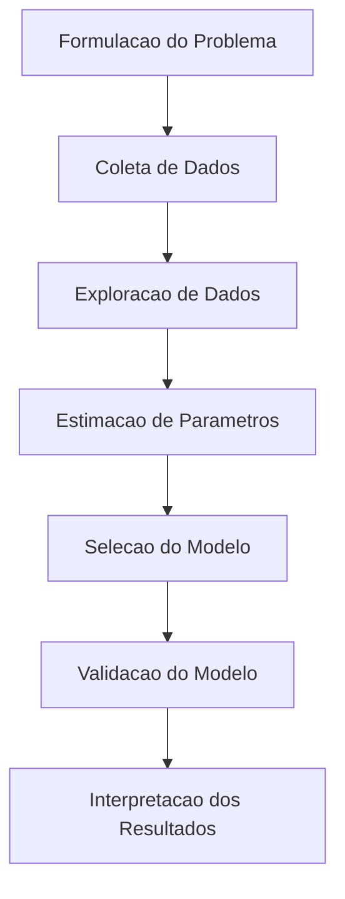
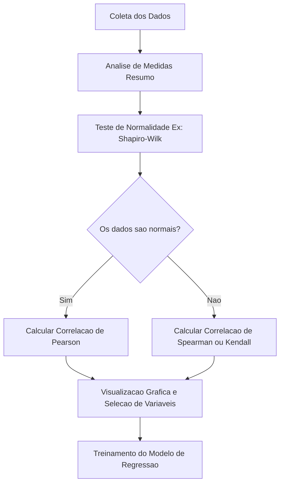
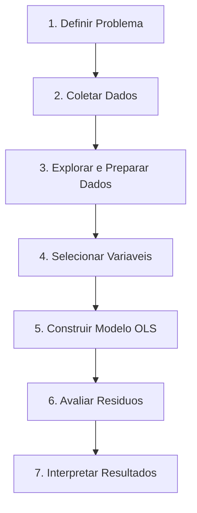
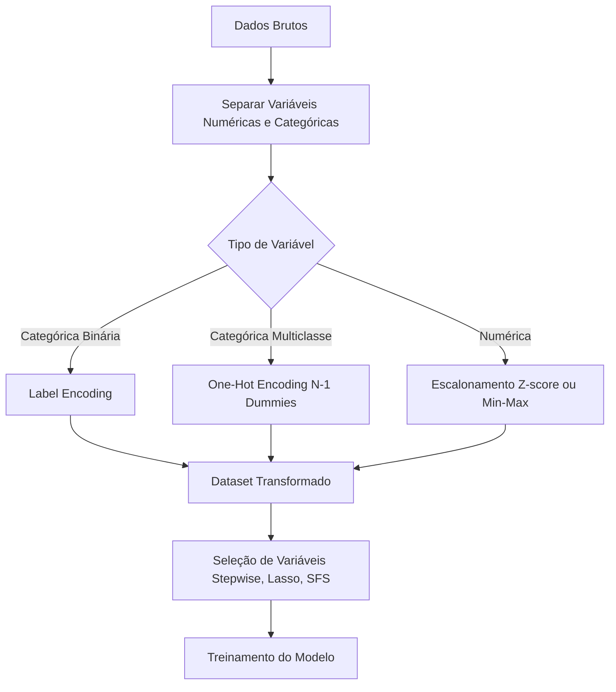

# Unidade I: Regressão Linear Simples e Múltipla

---

## Notas de Estudo: Fundamentos de Modelos Estatísticos e Regressão Linear

### Introdução à Modelagem Estatística

A modelagem estatística desempenha um papel fundamental na análise de dados e na tomada de decisões. Um modelo estatístico é uma representação simplificada e abstrata de um fenômeno ou sistema real, construída com base em princípios estatísticos e matemáticos. Seu propósito principal é descrever a relação entre variáveis, fornecendo uma estrutura estruturada para entender, analisar e prever dados em diversos contextos.

Nas ciências de dados, esses modelos são amplamente utilizados para compreender padrões complexos, explorar relações intrínsecas nos dados e embasar decisões corporativas em evidências quantitativas sólidas.

### Por Que Modelar?

A construção de modelos estatísticos é guiada por três pilares essenciais:

- Compreensão do fenômeno: Permite entender como diferentes variáveis interagem e se influenciam mutuamente, extraindo insights profundos sobre o sistema estudado.
- Previsão e predição: Possibilita a projeção de resultados futuros com base em dados históricos, sendo uma ferramenta inestimável para planejamento estratégico.
- Teste de hipóteses: Ajuda a avaliar a significância estatística de diferentes fatores, determinando se uma relação observada é genuína ou mero resultado do acaso.

### Objetivos da Modelagem Estatística

A aplicação prática dos modelos atende aos seguintes objetivos de negócios e pesquisa:

- Descrição: Resumir dados para identificar tendências e comunicar informações complexas de forma clara.
- Inferência: Generalizar conclusões sobre uma população inteira a partir do estudo de uma amostra representativa.
- Previsão: Antecipar eventos e tendências para tomada de decisão proativa.
- Controle e otimização: Identificar fatores-chave de sucesso para otimizar processos e induzir a melhoria contínua.

### Os 5 Principais Modelos Estatísticos

No arsenal do cientista de dados, destacam-se cinco famílias principais de modelos clássicos:

1. Regressão Linear
2. Análise de Variância (ANOVA)
3. Regressão Logística
4. Análise de Sobrevivência
5. Séries Temporais

### Etapas da Modelagem Estatística

O ciclo de vida do desenvolvimento de um modelo estatístico segue um fluxo lógico e iterativo. O diagrama abaixo ilustra essas etapas de forma sequencial.



### Fundamentos da Regressão Linear

A Regressão Linear é a base matemática para muitos algoritmos preditivos. Seu objetivo é modelar a relação entre uma variável dependente (alvo) e uma ou mais variáveis independentes (preditoras).

#### Formulação do Modelo

A equação clássica da reta de regressão linear simples é expressa por:

$$Y = \beta_0 + \beta_1 X + \epsilon$$

Onde:

- $Y$ representa a variável dependente (o que queremos prever).
- $X$ representa a variável independente (o preditor).
- $\beta_0$ é o coeficiente linear (intercepto), indicando o valor de $Y$ quando $X$ é zero.
- $\beta_1$ é o coeficiente angular (inclinação), indicando a taxa de variação de $Y$ para cada unidade de variação em $X$.
- $\epsilon$ é o termo de erro, que captura a variância não explicada pelo modelo.

#### Método dos Mínimos Quadrados Ordinários (OLS)

A estimação dos parâmetros $\beta_0$ e $\beta_1$ é geralmente feita pelo método dos Mínimos Quadrados. Este método busca encontrar a reta que minimiza a soma dos quadrados das diferenças (resíduos) entre os valores observados e os valores previstos pelo modelo.

### Avaliação da Qualidade do Ajuste do Modelo

Após a construção do modelo, é imprescindível validar sua confiabilidade:

- Coeficiente de Determinação (R² ajustado): Mede a proporção da variabilidade da variável dependente que é explicada pelas variáveis independentes. O R² ajustado penaliza a inclusão de variáveis irrelevantes no modelo de regressão múltipla, sendo uma métrica mais robusta que o R² simples.
- F-teste de significância global: Avalia se pelo menos uma das variáveis independentes tem poder preditivo sobre a variável dependente, validando a utilidade geral do modelo.

### Diagnósticos e Problemas Potenciais

A validade de um modelo de regressão linear depende do atendimento a certas premissas estatísticas. Violações dessas premissas exigem correção:

- Multicolinearidade: Ocorre quando variáveis independentes são altamente correlacionadas entre si. Isso distorce a interpretação dos coeficientes individuais e infla a variância das estimativas.
- Heterocedasticidade: Refere-se à situação em que a variância dos erros não é constante ao longo de todas as observações. Isso compromete a validade dos testes de significância estatística.

### Insights / Conexão com IA/ML

A transição da modelagem estatística clássica para o Aprendizado de Máquina (Machine Learning) moderno é contínua. Em IA, a 'Regressão Linear' frequentemente atua como o 'modelo baseline' fundamental. Antes de aplicar algoritmos complexos como Redes Neurais ou Gradient Boosting, cientistas de dados treinam um modelo de regressão para estabelecer um referencial de performance.

Além disso, conceitos estatísticos como 'termo de erro', 'estimação de parâmetros' e 'validação' formam a base matemática para o treinamento de qualquer inteligência artificial. A otimização dos pesos em uma rede neural profunda, por exemplo, é uma evolução conceitual do método dos mínimos quadrados, utilizando descida de gradiente para minimizar as funções de perda num espaço de alta dimensionalidade.

---

## Notas de Estudo: Fundamentos de Regressao e Medidas de Associacao

Este documento organiza os conceitos fundamentais sobre analise descritiva, modelos de regressao e calculo de correlacao, integrando teoria estatistica com implementacao pratica em Python. Estes fundamentos sao essenciais para a fase de analise exploratoria de dados (EDA) em projetos de Inteligencia Artificial e Machine Learning.

### 1. Medidas Resumo

As medidas resumo ajudam a compreender a distribuicao e o comportamento dos dados antes de aplicarmos modelos preditivos. Elas se dividem em tres categorias principais:

- **Medidas de Centralidade:** Buscam resumir o conjunto de dados em um unico valor representativo.
  - _Media:_ Valor medio do conjunto.
  - _Mediana:_ Valor central que divide os dados ao meio. Menos sensivel a valores atipicos (outliers).
  - _Moda:_ Valor que ocorre com maior frequencia.
- **Medidas de Dispersao:** Avaliam o grau de espalhamento dos dados em torno do centro.
  - _Variancia:_ Media dos quadrados das diferencas em relacao a media.
  - _Desvio Padrao:_ Raiz quadrada da variancia, retornando a medida para a escala original dos dados.
- **Medidas de Posicao Relativa:** Dividem os dados em partes iguais para entender a distribuicao percentual.
  - _Quartis:_ Dividem a amostra em quatro partes iguais (25%, 50%, 75%).
  - _Percentis:_ Dividem a amostra em cem partes iguais.

### 2. Medidas de Associacao e Correlacao

Para entender como duas variaveis se comportam em conjunto (ex: como o preco de uma casa varia em relacao ao seu tamanho), utilizamos medidas de associacao.

- **Direcao da Correlacao:**
  - _Positiva:_ Quando uma variavel cresce, a outra tambem cresce.
  - _Negativa:_ Quando uma variavel cresce, a outra decresce.
  - _Nula:_ Nao ha padrao de crescimento conjunto identificavel.
- **Forma da Correlacao:** Pode ser Linear, Exponencial ou em forma de U, por exemplo.
- **Forca da Correlacao:** Avaliada entre -1 e 1. Valores proximos as extremidades indicam associacao forte (positiva ou negativa), e valores proximos a zero indicam associacao fraca ou inexistente.

### 3. Principais Coeficientes de Correlacao

#### Coeficiente de Pearson

Mede a associacao linear entre variaveis continuas que seguem uma distribuicao normal. Avalia se a relacao pode ser bem tracada por uma linha reta.

#### Coeficientes Nao-Parametricos (Spearman e Kendall)

Utilizados quando os dados nao seguem uma distribuicao normal ou quando se trata de variaveis ordinais. Eles avaliam a relacao baseada nos postos (rank) dos dados, e nao em seus valores absolutos.

_Fórmula da Correlacao de Spearman:_
$$r_{R} = 1 - \frac{6\sum_{i}{d_{i}}^{2}}{n(n^{2}-1)}$$
Onde $d_{i}$ e a diferenca entre os postos dos pares de observacoes, e $n$ e o numero de pares.

### Fluxo de Analise de Correlacao em IA/ML



### 4. Estudo de Caso: Analise de Gorjetas com Python

Com base nos materiais, realizamos uma exploracao pratica utilizando o dataset 'tips' (gorjetas em um restaurante), que visa entender a relacao entre o total da conta, tamanho do grupo e o valor da gorjeta.

#### Passo 1: Importacao de Bibliotecas e Carga dos Dados

```python
import pandas as pd
import seaborn as sns
import matplotlib.pyplot as plt
from scipy.stats import pearsonr, spearmanr, kendalltau, shapiro

# Carregando o dataset de gorjetas
df = sns.load_dataset('tips')
```

#### Passo 2: Analise Exploratoria Inicial (Medidas Resumo)

```python
# Identificando o tipo das variaveis
print(df.dtypes)

# Isolando as variaveis numericas e extraindo medidas resumo
numericas = df.select_dtypes(include='number')
resumo = numericas.describe()
print(resumo)
```

_Resultado esperado:_ O dataset exibira as contagens, medias, desvios padroes e quartis de variaveis como 'total_bill' (total da conta) e 'tip' (gorjeta). A media do total da conta ajuda a ancorar os padroes de consumo.

#### Passo 3: Calculo das Correlacoes e Teste de Normalidade

Apos compreender as medidas de centralidade e dispersao, devemos testar a distribuicao (ex: usando o metodo de Shapiro-Wilk importado da scipy.stats) para decidir qual coeficiente adotar. Como visto no material, variaveis financeiras reais costumam ser assimetricas, validando o uso de testes nao-parametricos.

```python
# Matriz de Correlacao de Pearson (padrao do pandas)
correlacao_pearson = numericas.corr(method='pearson')

# Matriz de Correlacao de Spearman
correlacao_spearman = numericas.corr(method='spearman')

# Matriz de Correlacao de Kendall
correlacao_kendall = numericas.corr(method='kendall')
```

### 5. Insights / Conexao com IA/ML

A analise de associacao e o primeiro passo no desenvolvimento de modelos de **Regressao Linear** em Machine Learning. Na pratica industrial:

- **Selecao de Features (Feature Selection):** Variaveis que possuem forte correlacao com a variavel alvo (ex: 'total_bill' em relacao a 'tip') sao excelentes preditores para algoritmos de regressao.
- **Deteccao de Multicolinearidade:** Se duas variaveis de entrada (features) possuirem uma correlacao muito forte (proxima de 1) entre si, isso pode desestabilizar os pesos de um modelo de Regressao Linear. O analista de dados utiliza as matrizes de correlacao para descartar caracteristicas redundantes.
- **Robustez Nao-Parametrica:** Em cenarios reais, poucos dados seguem distribuicoes normais perfeitas. Dominar os conceitos de postos e as correlacoes de Spearman e Kendall e vital para validar relacoes monotonicas que modelos baseados em arvores (como Random Forest ou XGBoost) capturarao de forma muito mais eficiente do que as regressoes estritamente lineares.

---

## Notas de Estudo: Pós-Graduação em IA e ML - Regressão Linear

### 1. Fundamentos de Modelos de Regressão

Os modelos de regressão são técnicas estatísticas focadas em modelar a relação entre uma variável dependente (também chamada de resposta ou saída) e uma ou mais variáveis independentes (preditoras ou de entrada). No mercado, isso é amplamente utilizado para prever valores contínuos, como estimar o faturamento futuro de uma empresa ou precificar imóveis com base em suas características.

- **Direção do Relacionamento**: A relação assume uma direção única, onde a variável independente (X) explica a variação da variável dependente (Y).
- **Fluxo do Modelo**:


### 2. Escolhendo o Tipo de Regressão

Existem múltiplos algoritmos para diferentes contextos, incluindo Regressão Linear Simples e Múltipla, Logística, Polinomial, Ridge, Lasso e ElasticNet.

Para escolher o modelo ideal e diagnosticar sua saúde, deve-se observar os seguintes fatores:

- **Outliers**: Valores atípicos e discrepantes que podem distorcer o ajuste do modelo.
- **Normalidade dos Resíduos**: Os erros devem apresentar distribuição simétrica, com as medidas de centralidade tendendo à igualdade.
- **Multicolinearidade**: Ocorre quando variáveis independentes são altamente correlacionadas entre si, prejudicando a interpretabilidade.
- **Homocedasticidade**: Exige homogeneidade da variância dos erros ao longo dos dados.
- **Qualidade do Ajuste**: É vital monitorar se há 'Underfitting' (o algoritmo não se encaixa nos dados de entrada) ou 'Overfitting' (o algoritmo decora os dados de treino, mas falha em dados novos de teste).

### 3. Regressão Linear Simples

A Regressão Linear Simples é utilizada para prever valores contínuos e entender a relação linear (através de uma linha reta) entre exata 1 variável dependente e 1 variável independente. Exige-se que a relação seja linear e possua correlação de moderada a forte.

- **Equação Matemática**:
  $$ \hat{Y_i} = \hat{\beta_0} + \hat{\beta_1}X_i + e_i $$
- **Componentes da Fórmula**:
  - 'Y': Variável Dependente.
  - 'X': Variável Independente.
  - '$\beta_0$' (Intercepto): Ponto de intersecção, o valor de Y quando X é zero.
  - '$\beta_1$' (Coeficiente Angular): Inclinação da reta, indicando a taxa de variação.
  - '$e_i$' (Erro Aleatório ou Valor Residual): A diferença entre o valor real observado e o valor previsto pela reta ($e_i = y_i - \hat{y}_i$).

### 4. Estimação dos Parâmetros

O objetivo da estimação de parâmetros é encontrar a função que minimize os erros do modelo. O método central utilizado é a minimização do Erro Quadrático Total (EQT).

- **Forma Algébrica**:
  - O Erro Quadrático Total é a soma dos resíduos ao quadrado: $EQT = \sum_{i=1}^{n} (Y_i - \hat{\theta})^2$.
  - Através de derivadas parciais igualadas a zero, encontramos os valores ótimos.
  - Cálculo do Coeficiente Angular: $\hat{\beta_1} = \frac{Cov(X,Y)}{Var(X)}$.
  - Cálculo do Intercepto: $\hat{\beta_0} = \overline{Y} - \hat{\beta_1}\overline{X}$.
- **Forma Matricial**:
  - O modelo é representado vetorialmente como $Y = XB + e$.
  - A Soma dos Quadrados dos Resíduos (SQR) é definida por $SQR = e'e = (Y - XB)'(Y - XB)$.
  - Minimizando a função matricial, isolamos os coeficientes: $\hat{B} = (X'X)^{-1}X'Y$.

### 5. Premissas da Regressão Linear e Análise de Resíduos

Para garantir que as inferências do modelo sejam estatisticamente válidas, quatro premissas de resíduos devem ser atestadas:

- **Análise de Outliers**: Mapeada visualmente por meio do Gráfico de Resíduos Padronizados vs Valores Ajustados.
- **Normalidade dos Resíduos**:
  - A média dos resíduos deve ser igual a 0.
  - Teste de Shapiro-Wilk: Define a Hipótese Nula ($H_0$) como uma distribuição normal. Um p-valor > 0.05 indica que os resíduos seguem a normalidade.
- **Homocedasticidade**:
  - A variância dos erros deve ser constante ($\sigma^2 =$ constante) independentemente dos valores das variáveis explanatórias.
  - Caso a dispersão cresça linearmente ou de maneira quadrática com X, ocorre o fenômeno prejudicial chamado Heterocedasticidade.
  - Teste de Breusch-Pagan: Testa a hipótese de homocedasticidade; um p-valor > 0.05 atesta que ela existe.

### 6. Avaliação e Validação do Modelo

Após ajustar a reta, é imperativo validar o peso estatístico de cada variável e a robustez global do modelo criado.

- **Teste T (Significância de Parâmetros)**:
  - Avalia individualmente se um coeficiente $\beta$ tem efeito significativo sobre Y.
  - A estatística segue uma distribuição t de Student: $t = \frac{\hat{\beta_1}}{SE(\hat{\beta_1})}$.
  - $H_0: \beta = 0$. Em modelagens confiáveis, busca-se rejeitar $H_0$ obtendo um p-valor < 0.05.
- **Teste F (Significância Global)**:
  - Comumente usado em regressão múltipla, avalia se ao menos uma das variáveis independentes tem efeito estatisticamente significativo.
  - $F = \frac{SQR/q}{SQE/(n-k-1)}$.
  - Um p-valor < 0.05 (ou F calculado > F crítico) sinaliza que o modelo como um todo é útil.
- **Coeficiente de Determinação ($R^2$)**:
  - Métrica que estima a proporção da variabilidade da variável dependente (Y) que é explicada pelas variáveis independentes do modelo.
  - Fórmula: $R^2 = \frac{SQR}{SQT}$.
  - Sua escala vai de 0 (independência linear completa) a 1 (relação linear perfeita e exata).

### Insights / Conexão com IA/ML

A Regressão Linear atua como o modelo 'baseline' (ponto de partida e referência) primário em tarefas preditivas de Machine Learning para dados numéricos contínuos. Apesar de sua simplicidade frente a algoritmos densos, sua vantagem absoluta é a **interpretabilidade**: a magnitude e o sinal dos coeficientes ($\beta$) revelam de forma transparente a influência de cada 'feature' de entrada no resultado, fator crítico para negócios de risco financeiro ou saúde. Além disso, a minimização dos Mínimos Quadrados (EQT ou SQE) detalhada nestas notas embasa matematicamente o MSE (Mean Squared Error), que é a principal 'Loss Function' (função de perda) minimizada via gradiente descendente ao treinar Redes Neurais complexas.

---

## Notas de Estudo: Regressão Linear Múltipla em Inteligência Artificial e Machine Learning

A regressão linear múltipla é uma evolução direta da regressão linear simples. Enquanto a versão simples modela a relação entre uma variável dependente e uma única variável independente, a regressão múltipla lida com sistemas onde a variável dependente é influenciada por duas ou mais variáveis independentes simultaneamente. No mercado de dados e Machine Learning, este algoritmo é a espinha dorsal da modelagem preditiva inicial para dados tabulares, oferecendo um balanço ideal entre poder preditivo e interpretabilidade.

### Fundamentos Teóricos e Matemáticos

A equação fundamental que descreve o modelo é estruturada por um componente linear (com os coeficientes) somado a um termo de erro:

$$ \hat{Y}_{i} = \hat{\beta}_{0} + \hat{\beta}_{1}X_{i} + \hat{\beta}_{2}Z_{i} + ... + \hat{\beta}_{n}K_{i} + e\_{i} $$

Onde temos a seguinte decomposição dos elementos:

- $\hat{Y}_{i}$: Variável dependente ou variável alvo (o valor que o modelo deve prever).
- $\hat{\beta}_{0}$: Intercepto (o valor predito de Y quando todas as variáveis independentes assumem o valor zero).
- $\hat{\beta}_{1} ... \hat{\beta}_{n}$: Coeficientes das variáveis independentes (indicam o peso matemático de cada feature no modelo).
- $X_{i}, Z_{i}, K_{i}$: Variáveis independentes (features de entrada).
- $e_{i}$: Componente do erro aleatório ou resíduo (diferença entre o valor real e o predito).

### Estimativa dos Coeficientes: Abordagem Matricial

Para viabilizar o processamento computacional em larga escala exigido no Machine Learning, a notação matricial é amplamente adotada:

$$ Y = XB + e $$

O objetivo do treinamento do modelo é minimizar a métrica de erro, calculada através da Soma dos Quadrados dos Resíduos (SQR):

$$ SQR = e'e = (Y - XB)'(Y - XB) $$
$$ SQR = Y'Y - 2B'X'Y + B'X'XB $$

Para encontrar o ajuste ótimo (coeficientes que minimizam o erro), calcula-se a derivada parcial da função SQR em relação a B e iguala-se a zero (Equação Normal):

$$ \frac{\partial SQR}{\partial B} = -2X'Y + 2B'X'X = 0 $$
$$ \hat{B} = (X'X)^{-1}X'Y $$

### Fluxo de Construção de um Modelo de Regressão

A metodologia para o desenvolvimento e treinamento segue um ciclo de vida rigoroso aplicado aos projetos de Ciência de Dados:

- 1 - Definir o Problema de Negócio ou de Pesquisa.
- 2 - Coletar os Dados brutos.
- 3 - Explorar os Dados (Análise Descritiva e Limpeza).
- 4 - Preparar os Dados para a modelagem.
- 5 - Selecionar as Variáveis de maior importância (Feature Selection).
- 6 - Construir e Treinar o Modelo.
- 7 - Avaliar o Modelo e os pressupostos matemáticos.
- 8 - Interpretar os Resultados para tomada de decisão.



### Estudo de Caso: Previsão da Nota de Redação do ENEM

O objetivo do laboratório prático é desenvolver um modelo matemático capaz de prever a nota geral de redação de um candidato do ENEM, utilizando como base as variáveis preditivas (notas de seus componentes isolados).

Etapa de Exploração e Preparação:

- A base original (enem_tratado.csv) possui milhares de registros detalhados (idade, município, raça, notas por área, etc.).
- Os dados foram filtrados para examinar o desempenho de um colégio específico (CO_ESCOLA = 35132287) a fim de criar um modelo contextualizado.
- Foram identificadas ausências de dados (valores missing) para garantir a integridade estatística da amostra isolada.

Seleção de Variáveis (Correlação):

- Para evitar ruído no modelo, calculou-se uma matriz de correlação (utilizando seaborn e pandas).
- As competências 2, 4 e 5 apresentaram uma alta relação matemática com a nota total.

Implementação da Regressão Múltipla via statsmodels:
Com o ambiente Python preparado, procedemos com a construção do modelo pelo método dos Mínimos Quadrados Ordinários (OLS):

```python
import statsmodels.formula.api as smf
import scipy.stats as stats

modelo = smf.ols('NOTA_REDACAO ~ COMP2 + COMP4 + COMP5', data = colegiox).fit()
residuos = modelo.resid
```

Avaliação e Validação de Pressupostos:
Modelos de regressão linear baseiam-se no pressuposto de que os erros do modelo (resíduos) devem seguir uma curva de distribuição normal para que o modelo seja válido e não viesado. Realiza-se o Teste de Shapiro-Wilk para esta comprovação.

Definição das Hipóteses:

- H0 (Nula): Os resíduos possuem uma distribuição normal (p-valor > 0.05).
- Ha (Alternativa): Os resíduos NÃO possuem uma distribuição normal (p-valor <= 0.05).

Resolução do Teste:

- Estatística de teste: 0.9847
- p-valor: 0.1543
- Passo a Passo da Conclusão: Como o p-valor calculado (0.1543) é estritamente maior que a tolerância de significância adotada convencionalmente (0.05), a hipótese nula não pode ser rejeitada. Confirma-se, portanto, que a distribuição dos resíduos é normal. O pressuposto matemático foi respeitado, o que certifica a validade do modelo preditivo construído.

### Insights / Conexão com IA/ML

- Explicabilidade do Negócio: Enquanto modelos avançados de IA frequentemente operam como caixas-pretas (Black Box), a Regressão Linear Múltipla é considerada uma White Box. Ela nos permite olhar para as estimativas de Beta ($\hat{B}$) e informar aos gestores exatamente o quanto o aumento de desempenho na Competência 4 impacta, em média, a pontuação final da redação.
- Raízes Otimizadoras: A derivação analítica que anula o gradiente da SQR é o pilar que suporta métodos iterativos de otimização complexos encontrados em Deep Learning, como o Gradient Descent.
- Engenharia de Variáveis Inteligente (Feature Engineering): A aplicação da matriz de correlação e a eliminação de features pouco preditivas mostra um princípio valioso da Inteligência Artificial: menos variáveis com forte poder de sinal geram generalização superior e combatem frontalmente a ameaça de overfitting.

---

## Notas de Estudo: Pós-Graduação em IA e ML - Transformação e Seleção de Variáveis

O pré-processamento de dados e a seleção de atributos são etapas fundamentais na construção de modelos preditivos robustos e precisos. A maioria dos algoritmos de Machine Learning requer entradas numéricas bem estruturadas, o que torna a transformação de variáveis uma habilidade essencial para qualquer cientista de dados[cite: 1].

### 1. Lidando com Variáveis Qualitativas

Diversos modelos exigem que todas as variáveis sejam numéricas, criando um desafio na incorporação de dados qualitativos importantes (como UF, Gênero, Escolaridade)[cite: 1].

- **Variáveis Dicotômicas (Label Encoding)**:
  - Consiste em atribuir 0 ou 1 para variáveis que possuem apenas duas categorias (ex.: 'Feminino' = 1, 'Masculino' = 0)[cite: 1, 3].
  - **Atenção**: Não deve ser utilizado para variáveis nominais não dicotômicas (com mais de duas categorias, como 'Estado'), pois o modelo pode interpretar a ordem numérica como uma relação de grandeza e peso (ex.: atribuir peso 4 ao ES e peso 1 a MG)[cite: 1, 3].
- **One-Hot Encoding (Variáveis Dummy)**:
  - Cria variáveis binárias para representar variáveis categóricas nominais com múltiplas categorias[cite: 1].
  - **Regra do N-1**: Para representar 'N' categorias, criam-se 'N-1' variáveis Dummy. A categoria omitida é representada quando todas as outras Dummies assumem valor 0, evitando redundância e multicolinearidade (o modelo absorve o valor médio da categoria baseída no intercepto $\hat{\beta}_{o}$)[cite: 1].

### 2. Escalonamento Numérico

Algoritmos que utilizam cálculos de distância (como KNN e SVM) ou métodos de otimização baseados em gradiente não funcionam bem quando os atributos de entrada possuem escalas muito discrepantes[cite: 1, 3]. Geralmente, não escalonamos a variável resposta ('Y')[cite: 1].

- **Normalização (Min-Max)**:
  - Desloca e redimensiona os valores para o intervalo restrito entre 0 e 1[cite: 1, 3].
  - Fórmula: $X_{normalizado}=\frac{X-X_{min}}{X_{max}-X_{min}}$[cite: 1].
  - Implementação: 'MinMaxScaler' no scikit-learn (Python) ou função 'rescale' no R[cite: 1, 3].
- **Padronização (Z-score)**:
  - Centraliza os dados com média 0 e desvio padrão 1. É mais tolerante a outliers e amplamente preferida em Regressões Lineares e PCA[cite: 1, 3].
  - Fórmula: $Z=\frac{x-\mu}{\sigma}$[cite: 1].
  - Implementação: 'StandardScaler' no scikit-learn (Python) ou 'scale' no R[cite: 1, 3].

### 3. Seleção de Variáveis (Feature Selection)

Reduz a complexidade do modelo, previne overfitting e melhora a interpretabilidade[cite: 2, 4].

- **Stepwise (Critério AIC)**:
  - Algoritmo iterativo que adiciona ('Forward') ou remove ('Backward') variáveis buscando minimizar o Critério de Informação de Akaike (AIC), que penaliza modelos com muitos parâmetros[cite: 2, 4].
- **Lasso (Regularização L1)**:
  - Aplica uma penalidade L1 que reduz coeficientes de variáveis irrelevantes ou altamente correlacionadas a zero exato[cite: 2, 4].
  - Determina-se o parâmetro ótimo de penalidade (lambda/alpha) via Validação Cruzada ('cv.glmnet' no R ou 'GridSearchCV' no Python)[cite: 2, 4].
- **SFS (Sequential Feature Selection)**:
  - Método computacional que avalia combinações de variáveis usando validação cruzada baseada em métricas como Erro Quadrático Médio (MSE). Permite etapas flutuantes onde variáveis podem ser reincluídas ou removidas no meio do processo ('floating=True')[cite: 4].

---

### Resolução de Exercícios e Fluxos

Abaixo estão as metodologias aplicadas e seus fluxos representativos.



#### Exercício R: Análise de Preços de Casas em Boston[cite: 2]

1.  **Objetivo**: Prever o valor médio das residências ('medv') com 14 variáveis disponíveis.
2.  **Abordagem Stepwise**: O modelo 'stepAIC' (direção='both') selecionou um subconjunto de variáveis, avaliando o trade-off entre complexidade e precisão.
3.  **Abordagem Lasso**: Os dados foram padronizados com 'scale(X)'. Aplicou-se validação cruzada de 10 folds ('cv.glmnet') para encontrar o 'lambda.min'. Coeficientes de variáveis menos relevantes foram forçados a 0.
4.  **Avaliação**: Os modelos foram comparados com base no MSE (Erro Quadrático Médio), R² e AIC, utilizando gráficos de barra facetados com 'ggplot2' para determinar o modelo mais parcimonioso e acurado.

#### Exercício Python: Progressão da Doença Diabética[cite: 4]

1.  **Exploração**: O modelo objetiva prever a progressão (variável quantitativa) usando 10 atributos de saúde (idade, sexo, bmi, pressão arterial, lipoproteínas).
2.  **Correlação**: O mapa de calor de Pearson indicou altas correlações entre progessão e 'bmi' (0.59), 's5' (0.57) e 'bp' (0.44).
3.  **Stepwise (AIC)**: Selecionou as variáveis: 'bmi', 's5', 'bp', 's1', 's2', 'sex'. (R² alcançado: 0.4627, MSE: 2846.29).
4.  **SFS**: Utilizou regressão linear iterativa (com floating ativado). Retornou o mesmo conjunto de variáveis do Stepwise.
5.  **Lasso**: Fez-se a sintonia fina do hiperparâmetro 'alpha' via GridSearch. Selecionou: 'sex', 'bmi', 'bp', 's1', 's3', 's5', 's6'. Alcançou melhor performance geral (R²: 0.4715, MSE: 2799.82).

### Insights e Conexão com o Mercado de IA/ML

- **Risco de Vazamento de Dados (Data Leakage)**: Ao aplicar técnicas como Padronização (Z-score) em um contexto profissional, é mandatório realizar o cálculo da média e desvio padrão **apenas** no conjunto de treinamento. Aplicar a transformação no dataset inteiro antes do split corrompe o teste com informações do futuro.
- **Parcimônia é Dinheiro**: Técnicas de seleção de variáveis como Lasso não apenas previnem overfitting, mas reduzem custos operacionais no mundo dos negócios. Em cenários de Big Data ou bancos de dados cloud (como AWS Redshift ou Google BigQuery), operar modelos de produção que dependem de 15 atributos cruciais é imensamente mais barato e ágil do que um modelo que requer extrair e processar 150 colunas de dados.
- **Decodificando Caixa Preta**: Executivos de negócios (como em análises de risco de crédito, citadas na nota sobre faixas de renda e escolaridade[cite: 1]) costumam rejeitar modelos altamente complexos sem interpretabilidade. O Stepwise e o Lasso preservam a regressão linear legível, permitindo explicar aos stakeholders exatamente _quais_ features impactam a pontuação, favorecendo a conformidade regulatória.

---

[Previous](../05-statistical-models/summary.md) | [Next](../05-statistical-models/02-generalized-linear-models.md)
