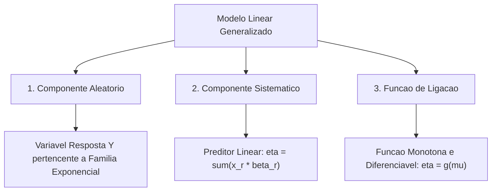
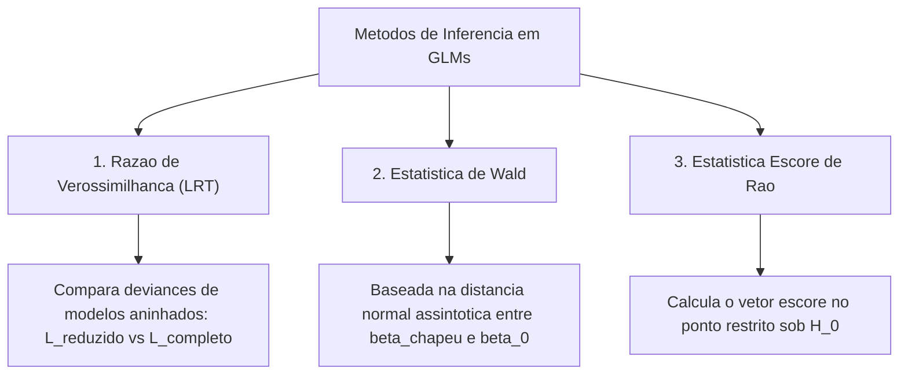
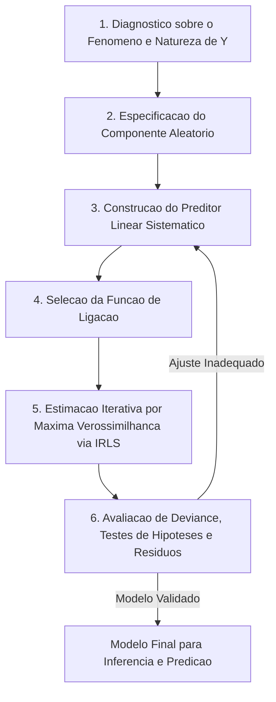
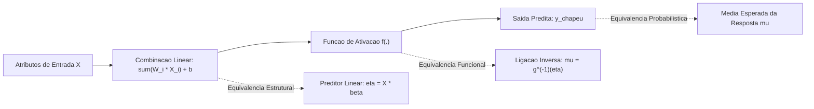

## Modelos Lineares Generalizados (GLMs): Guia Completo e Notas Aprofundadas

### 1. Introdução aos Modelos Lineares Generalizados (GLM)

- Contextualização e Papel da Seleção do Modelo: A seleção do arcabouço estatístico constitui o procedimento mais crítico na modelagem de fenômenos reais. Inferências causais, predições operacionais e dimensionamento de riscos dependem da aderência entre a estrutura matemática do modelo e a dinâmica probabilística geradora dos dados observados. O uso de um modelo inadequado propaga erros sistemáticos de estimação, conduzindo a conclusões de negócio enviesadas.
- O Modelo Linear Clássico e suas Premissas Restritivas: Na regressão linear tradicional, assume-se que a variável resposta $Y$ condicionada aos preditores segue uma distribuição Normal:
  $$Y \sim N(\mu, \sigma^2)$$
  O modelo estrutural é decomposto em $Y = X\beta + e$, exigindo o cumprimento rígido de quatro pressupostos:
  - Aditividade e linearidade dos efeitos das covariáveis.
  - Homocedasticidade: variância residual constante $\operatorname{Var}(e_i) = \sigma^2$ para todas as observações.
  - Independência condicional: covariância nula entre quaisquer pares de resíduos $\operatorname{Cov}(e_i, e_j) = 0, \forall i \neq j$.
  - Normalidade dos resíduos: $e \sim N(0, \sigma^2 I)$.
- Incompatibilidade com Dados Discretos e Contínuos Restritos:
  - Variáveis Discretas: Fenômenos baseados em contagens enumeráveis (número de sinistros de seguros, contagem de acessos em servidores, número de falhas mecânicas) ou desfechos qualitativos (conversão binária, faixas de crédito) possuem suporte estritamente não negativo ou categórico. A aplicação do modelo clássico gera predições com valores fracionários sem sentido físico, probabilidades fora do intervalo unitário $[0, 1]$ ou números negativos.
  - Variáveis Contínuas Assimétricas: Dados de tempo de vida, custos assistenciais ou faturamento apresentam assimetria à direita e variância intrinsecamente dependente da média esperada, violando frontalmente a homocedasticidade.
- Limitações Práticas da Transformação de Box-Cox: Historicamente, antes da consolidação dos recursos computacionais iterativos, utilizava-se a transformação de Box-Cox sobre $Y > 0$:
  $$z = \begin{cases} \frac{y^\lambda - 1}{\lambda}, & \text{se } \lambda \neq 0 \\ \ln(y), & \text{se } \lambda = 0 \end{cases}$$
  Apesar de buscar estabilizar a variância e aproximar a simetria, caso as suposições subjacentes continuem violadas a transformação não ajusta os dados adequadamente. Além disso, a transformação distorce a escala original, comprometendo a interpretabilidade direta dos parâmetros para tomadas de decisão de negócio.
- O Marco Unificador dos GLMs: Introduzidos por John Nelder e Robert Wedderburn em 1972, os GLMs propiciaram uma teoria unificada, permitindo modelar variáveis aleatórias pertencentes a toda a família exponencial de distribuições sem recorrer a transformações artificiais na resposta observada.

### 2. A Família Exponencial de Distribuições

- Origem e Propriedades Fundamentais: Nelder e Wedderburn constataram que a grande maioria dos problemas estatísticos de regressão pode ser generalizada a partir de uma classe comum de distribuições paramétricas. Quando o comportamento estocástico da variável dependente $Y$ pertence à Família Exponencial, a modelagem pode ser realizada preservando a escala original do fenômeno.
- Forma Canônica Uniparamétrica: Caracteriza-se por uma função de probabilidade ou de densidade que depende de um parâmetro de interesse $\theta$, estruturada algebricamente como:
  $$f(x; \theta) = h(x) \exp[\eta(\theta) t(x) - b(\theta)]$$
  Onde:
  - $h(x)$ é uma função base não negativa que depende exclusivamente dos dados observados $x$.
  - $\eta(\theta)$ é a função de parâmetro natural. Na forma canônica pura, define-se $\eta(\theta) = \theta$, assumindo $\theta$ o papel de parâmetro canônico.
  - $t(x)$ é a estatística suficiente do modelo. Quando coincide com a função identidade, tem-se $t(x) = x$.
  - $b(\theta)$ é a função cumulante geradora (ou log-função de partição), responsável por garantir que a integração ou soma total da densidade sobre o suporte seja unitária.
- Distribuição Conjunta para Amostras Independentes e Identicamente Distribuídas: Sendo $X_1, \dots, X_n$ observações i.i.d., a função de densidade conjunta é dada pelo produto direto:
  $$f(x_1, \dots, x_n; \theta) = \left[ \prod_{i=1}^n h(x_i) \right] \exp\left[ \theta \sum_{i=1}^n x_i - n b(\theta) \right]$$
  Esta estrutura evidencia que a soma amostral $\sum_{i=1}^n x_i$ é a estatística suficiente conjunta para o parâmetro canônico $\theta$.
- Propriedades Analíticas dos Momentos via Função Cumulante: A grande vantagem computacional da parametrização canônica reside na extração dos momentos da distribuição a partir das derivadas sucessivas da função $b(\theta)$:
  - Log-verossimilhança individual: $l(\theta) = \ln h(x) + \theta x - b(\theta)$.
  - Função Escore: $U(\theta) = \frac{\partial l}{\partial \theta} = x - b'(\theta)$. Como pela teoria assintótica clássica o valor esperado da função escore é nulo ($E[U(\theta)] = 0$), obtém-se diretamente:
    $$E(X) = b'(\theta)$$
  - Variância: Utilizando a relação da informação de Fisher $\operatorname{Var}(U) = E(U^2) = -E[U'(\theta)] = b''(\theta)$, conclui-se que:
    $$\operatorname{Var}(X) = b''(\theta)$$
- Resolução Detalhada do Exercício da Distribuição de Rayleigh:
  - Enunciado: Demonstrar que a distribuição de Rayleigh, adotada em análises de grandezas físicas contínuas positivas ($x > 0, \theta > 0$) com função densidade $f(x; \theta) = \frac{x}{\theta^2} \exp\left(-\frac{x^2}{2\theta^2}\right)$, pertence à família exponencial uniparamétrica.
  - Passo 1: Reescreve-se o fator multiplicativo $\frac{1}{\theta^2}$ utilizando a base exponencial e logarítmica: $\frac{1}{\theta^2} = \exp[\ln(\theta^{-2})] = \exp[-2\ln(\theta)]$.
  - Passo 2: Combina-se o termo com a exponencial original da distribuição:
    $$f(x; \theta) = x \exp[-2\ln(\theta)] \exp\left(-\frac{x^2}{2\theta^2}\right) = x \exp\left[ -\frac{1}{2\theta^2} x^2 - 2\ln(\theta) \right]$$
  - Passo 3: Compara-se a expressão resultante com a forma geral $f(x; \theta) = h(x) \exp[\eta(\theta) t(x) - b(\theta)]$, identificando:
    - $h(x) = x$
    - $\eta(\theta) = -\frac{1}{2\theta^2}$
    - $t(x) = x^2$
    - $b(\theta) = 2\ln(\theta)$
  - Conclusão: Resta demonstrado que a distribuição de Rayleigh é um membro legítimo da família exponencial.

### 3. Família Exponencial com Parâmetro de Dispersão

- Extensão para Dois Parâmetros: Em aplicações práticas, fenômenos reais frequentemente demandam um parâmetro de escala ou variância independente da localização. Introduz-se, assim, a Família Exponencial com Parâmetro de Dispersão $\phi$:
  $$f(y; \theta, \phi) = \exp\left\{ \frac{y\theta - b(\theta)}{a(\phi)} + c(y, \phi) \right\}$$
  Onde $\theta$ atua como o parâmetro canônico de localização e $\phi$ atua como parâmetro de dispersão (ou perturbação residual).
- Função de Dispersão $a(\phi)$: Na esmagadora maioria das distribuições usuais, define-se $a(\phi) = \phi$ ou $a(\phi) = \frac{\phi}{w_i}$, onde $w_i$ representa um peso analítico a priori atribuído a cada observação.
- Precisão do Modelo: A precisão da observação é mensurada analiticamente pelo inverso da dispersão, expressa por $\phi^{-1}$. Quanto menor a perturbação residual $\phi$, maior é a certeza inferencial associada ao ajuste do modelo.
- Momentos Gerais com Dispersão:
  - Esperança Matemática: $E(Y) = \mu = b'(\theta)$. O valor esperado independe do parâmetro de dispersão $\phi$.
  - Variância Geral da Resposta: $\operatorname{Var}(Y) = b''(\theta) a(\phi) = \phi V(\mu)$, onde $V(\mu) = b''(\theta)$ é a Função de Variância.
- Relação Funcional entre Média e Variância: Diferente do modelo linear clássico (no qual média e variância são completamente desacopladas), nos GLMs a variância é intrinsecamente modulada pelo nível esperado da resposta $\mu$ através da função $V(\mu)$:
  - Distribuição Normal: $\theta = \mu$, $b(\theta) = \frac{\theta^2}{2}$, $V(\mu) = 1$, $\phi = \sigma^2 \implies \operatorname{Var}(Y) = \sigma^2$.
  - Distribuição Bernoulli: $\theta = \ln\left(\frac{\mu}{1-\mu}\right)$, $b(\theta) = \ln(1 + e^\theta)$, $V(\mu) = \mu(1 - \mu)$, $\phi = 1 \implies \operatorname{Var}(Y) = \mu(1 - \mu)$.
  - Distribuição Poisson: $\theta = \ln(\mu)$, $b(\theta) = e^\theta$, $V(\mu) = \mu$, $\phi = 1 \implies \operatorname{Var}(Y) = \mu$ (equidispersão).
  - Distribuição Gama: $\theta = -\frac{1}{\mu}$, $b(\theta) = -\ln(-\theta)$, $V(\mu) = \mu^2$, $\operatorname{Var}(Y) = \phi \mu^2$ (coeficiente de variação constante).

### 4. Definição Estrutural de um GLM

- Os Três Componentes Interligados: Todo GLM é estruturado a partir da integração coerente de três partes:

- Componente Aleatório: Especifica a variável dependente $Y$, composta por um vetor de observações independentes $(y_1, \dots, y_n)^T$. Assume-se que a distribuição de probabilidade de cada $Y_i$ pertença à família exponencial com densidade governada pelos parâmetros $\theta_i$ e $\phi$, exibindo média $\mu_i$ e variância $\phi V(\mu_i)$.
- Componente Sistemático: Representa a combinação linear das covariáveis explicativas independentes, definindo o Preditor Linear $\eta_i$:
  $$\eta_i = \sum_{r=1}^p x_{ir} \beta_r = x_i^T \beta$$
  Em notação matricial para todo o conjunto amostral, expressa-se por $\eta = X\beta$, onde $X$ é a matriz de delineamento (design matrix) de dimensão $n \times p$ e $\beta$ é o vetor de parâmetros desconhecidos de dimensão $p \times 1$.
- Função de Ligação (Link Function): Função matemática univariada $g(\cdot)$, estritamente monótona e continuamente diferenciável, encarregada de vincular formalmente o preditor linear à média esperada da variável resposta:
  $$\eta_i = g(\mu_i) \iff \mu_i = g^{-1}(\eta_i)$$
  A função de ligação viabiliza a transformação do suporte restrito de $\mu_i$ (como $[0, 1]$ em classificações ou $[0, \infty)$ em contagens) para a reta real ilimitada $[-\infty, +\infty]$ percorrida pelo preditor linear $\eta_i$.

### 5. Especificação de um GLM

- Critérios de Especificação do Componente Aleatório: A formulação inicial requer o exame da natureza empírica da variável $Y$:
  - Variáveis Contínuas: Respostas simétricas e sem limites físicos direcionam para a Normal; respostas estritamente positivas com assimetria positiva moderada direcionam para a Gama; respostas com cauda longa e dispersão acentuada sugerem a Normal Inversa.
  - Variáveis Discretas: Fenômenos binários ou contagens em número fixo de ensaios requerem Bernoulli ou Binomial; taxas de eventos independentes no tempo/espaço direcionam para Poisson; contagens com variância muito superior à média exigem a Binomial Negativa.
- Critérios de Especificação do Componente Sistemático:
  - Seleção criteriosa das covariáveis explicativas relevantes para o domínio de negócio.
  - Decisão sobre inclusão de termos de interação multiplicativa ($X_1 \cdot X_2$) para capturar dependências condicionais entre fatores.
  - Avaliação de efeitos polinomiais ($X^2$) para modelar curvaturas contínuas.
  - Codificação de variáveis qualitativas via variáveis indicadoras (dummies), fixando categorias de referência para preservar a estabilidade da matriz $X$.
- Critérios de Especificação da Função de Ligação:
  - Deve mapear estritamente o espaço paramétrico admissível da média para a reta real: $g: \Omega_\mu \to \mathbb{R}$.
  - Função de Ligação Canônica: Ocorre quando $g(\mu_i) = \theta_i$. O preditor linear liga-se diretamente ao parâmetro natural da distribuição. Vantagens teóricas das ligações canônicas:
    - O vetor escore e a matriz de informação de Fisher simplificam-se substancialmente.
    - As matrizes de informação observada e esperada tornam-se idênticas ($J = K$).
    - Assegura propriedades estatísticas ideais para os estimadores, eliminando problemas de convergência numérica durante a maximização da verossimilhança.
  - Tabela de Ligações Canônicas Usuais:
    - Normal: Identidade $\eta = \mu$.
    - Bernoulli/Binomial: Logito $\eta = \ln\left(\frac{\mu}{1 - \mu}\right)$.
    - Poisson: Logarítmica $\eta = \ln(\mu)$.
    - Gama: Recíproca $\eta = \mu^{-1}$.
    - Normal Inversa: Quadrática inversa $\eta = \mu^{-2}$.

### 6. Estimação de Parâmetros e Vetor Escore

- Princípio da Máxima Verossimilhança em GLMs: Dado o vetor de variáveis respostas independentes $y = (y_1, \dots, y_n)^T$, o logaritmo da função de verossimilhança global assume a forma aditiva:
  $$l(\beta) = \sum_{i=1}^n l_i(\theta_i, \phi; y_i) = \sum_{i=1}^n \left\{ \frac{y_i \theta_i - b(\theta_i)}{\phi} + c(y_i, \phi) \right\}$$
  Assumindo-se inicialmente o parâmetro de dispersão $\phi$ conhecido, o objetivo é encontrar o vetor de parâmetros $\beta$ que maximiza $l(\beta)$.
- Obtenção do Vetor Escore via Regra da Cadeia: Os parâmetros $\beta_r$ influenciam a densidade através de uma cadeia composta de transformações:
  $$\beta_r \to \eta_i \to \mu_i \to \theta_i \to l_i$$
  Aplicando rigorosamente a regra da cadeia para a $r$-ésima coordenada do vetor escore:
  $$U_r(\beta) = \frac{\partial l(\beta)}{\partial \beta_r} = \sum_{i=1}^n \frac{\partial l_i}{\partial \theta_i} \cdot \frac{d\theta_i}{d\mu_i} \cdot \frac{d\mu_i}{d\eta_i} \cdot \frac{\partial \eta_i}{\partial \beta_r}$$
- Dedução Termo a Termo:
  - Derivada do log-verossimilhança pelo parâmetro canônico: $\frac{\partial l_i}{\partial \theta_i} = \frac{y_i - b'(\theta_i)}{\phi} = \frac{y_i - \mu_i}{\phi}$.
  - Derivada do parâmetro canônico pela média: Como $\mu_i = b'(\theta_i)$, tem-se $\frac{d\mu_i}{d\theta_i} = b''(\theta_i) = V(\mu_i)$, logo $\frac{d\theta_i}{d\mu_i} = \frac{1}{V(\mu_i)}$.
  - Derivada da média pelo preditor linear: Como $\eta_i = g(\mu_i)$, tem-se $\frac{d\eta_i}{d\mu_i} = g'(\mu_i)$, logo $\frac{d\mu_i}{d\eta_i} = \frac{1}{g'(\mu_i)}$.
  - Derivada do preditor pela covariável: Como $\eta_i = \sum_{r=1}^p x_{ir} \beta_r$, tem-se $\frac{\partial \eta_i}{\partial \beta_r} = x_{ir}$.
- Equações de Verossimilhança Finais: Substituindo os quatro fatores na expressão geral:
  $$U_r(\beta) = \phi^{-1} \sum_{i=1}^n \frac{(y_i - \mu_i) x_{ir}}{V(\mu_i) g'(\mu_i)} = 0, \quad \text{para } r = 1, \dots, p$$
  O sistema resultante não é linear em relação a $\beta$, impedindo o isolamento analítico direto e demandando métodos numéricos iterativos para sua resolução.

### 7. Estimação de Parâmetros: Algoritmo de Newton-Raphson

- Formulação Numérica Multivariada: Para solucionar o sistema de equações transcendentes $U(\beta) = 0$, adota-se o método de aproximação iterativa de Newton-Raphson baseado na expansão em série de Taylor de primeira ordem em torno da estimativa da iteração atual $\beta^{(m)}$:
  $$U(\beta) \approx U(\beta^{(m)}) + \left[ \frac{\partial U(\beta)}{\partial \beta} \right]_{\beta^{(m)}} (\beta - \beta^{(m)}) = 0$$
- Matriz de Informação Observada de Fisher ($J$): A matriz Jacobiana das primeiras derivadas do vetor escore com sinal invertido define a Matriz Hessiana negativa observada:
  $$J(\beta) = -\frac{\partial U(\beta)}{\partial \beta^T} = -\frac{\partial^2 l(\beta)}{\partial \beta \partial \beta^T}$$
- Equação de Atualização de Newton-Raphson: Isolando $\beta^{(m+1)}$ da aproximação linear:
  $$\beta^{(m+1)} = \beta^{(m)} + [J^{(m)}]^{-1} U^{(m)}$$
- Limitações e Desafios Computacionais do Método:
  - O cálculo explícito da matriz observada $J$ envolve segundas derivadas analíticas de alta complexidade algébrica, especialmente quando são adotadas funções de ligação não canônicas.
  - A matriz $J^{(m)}$ depende dos valores observados $y_i$. Caso a iteração inicial $\beta^{(0)}$ esteja distante do ponto ótimo, $J^{(m)}$ pode se tornar mal-condicionada ou não invertível, inviabilizando a convergência do algoritmo.

### 8. Estimação de Parâmetros: Método Escore de Fisher e IRLS

- Princípio do Método Escore de Fisher: Para sanar as dificuldades da matriz observada $J$, o método Escore de Fisher substitui a matriz $J$ pelo seu valor esperado sob o modelo teórico, denominado Matriz de Informação Esperada de Fisher $K$:
  $$K(\beta) = E[J(\beta)] = E\left[ -\frac{\partial^2 l(\beta)}{\partial \beta \partial \beta^T} \right] = E\left[ U(\beta) U(\beta)^T \right]$$
  A regra de iteração reescreve-se como:
  $$\beta^{(m+1)} = \beta^{(m)} + [K^{(m)}]^{-1} U^{(m)}$$
- Estrutura Matricial Elegante: Avaliando os elementos da matriz esperada $K$:
  $$K_{rs} = E\left[ -\frac{\partial U_r}{\partial \beta_s} \right] = \phi^{-1} \sum_{i=1}^n \frac{x_{ir} x_{is}}{V(\mu_i) [g'(\mu_i)]^2}$$
  Definindo a matriz de pesos diagonal $W = \operatorname{diag}(w_1, \dots, w_n)$, onde cada peso é dado por $w_i = \frac{1}{V(\mu_i) [g'(\mu_i)]^2}$, expressa-se a matriz de Fisher em notação matricial concisa:
  $$K = \phi^{-1} X^T W X$$
- O Algoritmo IRLS (Iteratively Reweighted Least Squares): Multiplicando a equação de atualização por $K^{(m)}$:
  $$K^{(m)} \beta^{(m+1)} = K^{(m)} \beta^{(m)} + U^{(m)}$$
  $$\phi^{-1} X^T W^{(m)} X \beta^{(m+1)} = \phi^{-1} X^T W^{(m)} \left[ X\beta^{(m)} + (W^{(m)})^{-1} \frac{\partial l}{\partial \eta} \right]$$
  Define-se o Vetor da Variável de Trabalho Ajustada $z^{(m)}$ com componentes:
  $$z_i^{(m)} = \eta_i^{(m)} + (y_i - \mu_i^{(m)}) g'(\mu_i^{(m)})$$
  A equação fundamental de atualização do IRLS consolida-se como um problema de regressão por Mínimos Quadrados Ponderados repetido a cada iteração:
  $$\beta^{(m+1)} = \left( X^T W^{(m)} X \right)^{-1} X^T W^{(m)} z^{(m)}$$
- Critério de Parada e Convergência: O processo itera sucessivamente atualizando $\eta^{(m)} \to \mu^{(m)} \to W^{(m)} \to z^{(m)} \to \beta^{(m+1)}$ até que a distância euclidiana ou variação relativa entre passos sucessivos satisfaça:
  $$\frac{\|\beta^{(m+1)} - \beta^{(m)}\|}{\|\beta^{(m)}\|} < \epsilon$$
  Onde $\epsilon$ é uma tolerância numérica típica na ordem de $10^{-6}$ a $10^{-8}$.

### 9. Inferência Aplicada aos GLMs e Teoria Assintótica

- Desafio das Distribuições Exatas: Em modelos lineares clássicos, a hipótese de normalidade permite derivar distribuições exatas $t$ de Student e $F$ de Snedecor para amostras pequenas. Nos GLMs gerais, as distribuições exatas dos estimadores $\hat{\beta}$ são matematicamente intratáveis. Por essa razão, a inferência apoia-se formalmente nos resultados assintóticos garantidos pela Teoria de Máxima Verossimilhança para grandes amostras ($n \to \infty$).
- Propriedades Assintóticas Fundamentais do Estimador de Máxima Verossimilhança ($\hat{\beta}$):
  - Consistência Forte: $\hat{\beta}$ converge quase certamente para o verdadeiro vetor de parâmetros $\beta$ à medida que o tamanho amostral $n$ cresce.
  - Não-Viesamento Assintótico: $E(\hat{\beta}) = \beta$, demonstrando que o viés de estimação tende a zero assintoticamente.
  - Normalidade Multivariada Assintótica: A distribuição limite de $\hat{\beta}$ é Gaussiana:
    $$\hat{\beta} \xrightarrow{a} N_p\left( \beta, K^{-1} \right)$$
- Matriz de Variâncias e Covariâncias dos Parâmetros: A precisão inferencial das estimativas provém do inverso da Matriz de Informação Esperada de Fisher:
  $$\operatorname{Cov}(\hat{\beta}) = K^{-1} = \phi \left( X^T W X \right)^{-1}$$
- Erro-Padrão Assintótico: Para cada coeficiente individual $\hat{\beta}_j$, seu erro-padrão assintótico $\operatorname{SE}(\hat{\beta}_j)$ é calculado pela raiz quadrada do $j$-ésimo elemento diagonal da matriz de covariância:
  $$\operatorname{SE}(\hat{\beta}_j) = \sqrt{[\operatorname{Cov}(\hat{\beta})]_{jj}}$$
  Estes erros-padrão são os denominadores indispensáveis na construção de testes de hipóteses de significância e intervalos de confiança.

### 10. Medidas de Discrepância: Função Desvio (Deviance)

- Conceito de Discrepância na Modelagem: O ajuste de um GLM consiste na substituição das observações brutas $y_i$ pelas médias estimadas $\hat{\mu}_i$. Uma medida de discrepância quantifica a perda de informação ou afastamento entre os dados observados e a superfície estimada pelo modelo.
- O Espectro de Complexidade dos Modelos:
  - Modelo Saturado (Completo): Possui $n$ parâmetros para $n$ observações ($p = n$). Ele se ajusta perfeitamente aos dados observados ($\hat{\mu}_i = y_i$), atingindo o limite superior teórico absoluto de verossimilhança $l(y; y)$, mas não provê síntese científica ou generalização.
  - Modelo Proposto: Modelo parcimonioso sob teste com $p$ parâmetros ($p < n$). Gera verossimilhança maximizada $l(\hat{\mu}; y)$.
  - Modelo Nulo: Modelo mais restritivo possível contendo apenas o intercepto comum $\beta_0$, assumindo médias iguais para todas as observações.
- Definição da Função Desvio (Deviance Residual): Definida analiticamente como duas vezes a diferença logarítmica de verossimilhança entre o modelo saturado e o modelo proposto:
  $$D^*(y; \hat{\mu}) = 2 [l(y; y) - l(\hat{\mu}; y)]$$
  Esta quantidade é denominada Deviance Escalonada (Scaled Deviance). A Deviance Residual não escalonada corresponde a:
  $$D(y; \hat{\mu}) = \phi D^*(y; \hat{\mu}) = 2\sum_{i=1}^n [y_i(\tilde{\theta}_i - \hat{\theta}_i) - (b(\tilde{\theta}_i) - b(\hat{\theta}_i))]$$
  Onde $\tilde{\theta}_i$ é o parâmetro avaliado no modelo saturado e $\hat{\theta}_i$ no modelo proposto.
- Distribuição Amostral e Graus de Liberdade: Sob a hipótese de que o modelo proposto é verdadeiro, a deviance escalonada segue assintoticamente uma distribuição Qui-Quadrado com $\nu = n - p$ graus de liberdade:
  $$D^*(y; \hat{\mu}) = \frac{D(y; \hat{\mu})}{\phi} \sim \chi^2_{(n - p)}$$
- Interpretação da Adequabilidade: Valores pequenos de deviance (associados a p-valores elevados) atestam que o modelo sob avaliação reproduz os dados tão bem quanto o modelo saturado. Por outro lado, razões $\frac{D(y; \hat{\mu})}{n - p} \gg 1$ evidenciam falta de ajuste grave, omissão de variáveis relevantes ou presença de sobredispersão.

### 11. Medidas de Discrepância: Estatística de Pearson

- Estatística Generalizada de Pearson: Representa uma medida alternativa de discrepância obtida pela soma das discrepâncias quadráticas padronizadas pela função de variância teórica do componente aleatório:
  $$X^2 = \sum_{i=1}^n \frac{(y_i - \hat{\mu}_i)^2}{V(\hat{\mu}_i)}$$
- Propriedades Amostrais: Para modelos bem ajustados pertencentes à família exponencial, a estatística de Pearson dividida pelo parâmetro de dispersão converge assintoticamente para a mesma distribuição Qui-Quadrado da deviance escalonada:
  $$\frac{X^2}{\phi} \sim \chi^2_{(n - p)}$$
- Casos Particulares Clássicos:
  - Distribuição Normal ($V(\mu) = 1$): A estatística $X^2$ reduz-se exatamente à soma de quadrados dos resíduos ordinários da regressão clássica: $X^2 = \sum_{i=1}^n (y_i - \hat{\mu}_i)^2$.
  - Distribuição Poisson ($V(\mu) = \mu$): Assume a forma tradicional da estatística Qui-Quadrado de Pearson para testes de aderência: $X^2 = \sum_{i=1}^n \frac{(y_i - \hat{\mu}_i)^2}{\hat{\mu}_i}$.
  - Distribuição Binomial/Bernoulli ($V(\mu) = \mu(1 - \mu)$): Corresponde à estatística Qui-Quadrado aplicada a tabelas de contingência e proporções.
- Sensibilidade Comparativa: Embora a deviance seja preferível para testes de hipóteses de comparação entre modelos aninhados via máxima verossimilhança, a estatística $X^2$ de Pearson é frequentemente mais robusta e preferível para estimar o parâmetro de dispersão residual em amostras moderadas.

### 12. Estimação do Parâmetro de Dispersão ($\phi$)

- Necessidade de Estimação: Enquanto nas distribuições Binomial e Poisson o parâmetro de dispersão é fixado teoricamente em $\phi = 1$, em distribuições contínuas como Normal, Gama e Normal Inversa $\phi$ é uma quantidade desconhecida da população. Sua correta estimação é obrigatória para calibrar os erros-padrão dos parâmetros estimados $\operatorname{Cov}(\hat{\beta}) = \phi(X^T W X)^{-1}$ e permitir inferências válidas.
- Método do Desvio: Baseia-se no fato de que o valor esperado assintótico da deviance não escalonada é $E[D(y; \hat{\mu})] = (n - p)\phi$. Define-se o estimador baseado no desvio residual como:
  $$\hat{\phi}_{\text{dev}} = \frac{D(y; \hat{\mu})}{n - p}$$
- Método de Pearson: Apoia-se na propriedade assintótica $E[X^2] = (n - p)\phi$. O estimador obtido a partir da estatística de Pearson generalizada é dado por:
  $$\hat{\phi}_{\text{Pearson}} = \frac{X^2}{n - p} = \frac{1}{n - p} \sum_{i=1}^n \frac{(y_i - \hat{\mu}_i)^2}{V(\hat{\mu}_i)}$$
- Comparação Teórica e Fenômeno da Sobredispersão (Overdispersion):
  - Na literatura estatística, o estimador de Pearson $\hat{\phi}_{\text{Pearson}}$ é amplamente considerado superior por fornecer estimativas consistentes com menor viés em amostras finitas.
  - Diagnóstico em Modelos de Contagem e Proporções: Ao ajustar modelos Poisson ou Binomiais (que impõem $\phi = 1$), a avaliação empírica de $\hat{\phi} = \frac{X^2}{n - p}$ permite diagnosticar anomalias nos dados. Valores de $\hat{\phi} > 1.2$ configuram sobredispersão, originada por correlação residual entre indivíduos, agregação espacial ou excesso de zeros. Ignorar a sobredispersão subestima os erros-padrão reais, inflando artificialmente as estatísticas de teste e gerando falsos positivos na identificação de preditores significantes.

### 13. Testes de Hipóteses para GLMs: Parte 1 (Fundamentos)

- Estrutura Geral das Hipóteses: A validação inferencial em GLMs visa avaliar restrições lineares sobre os coeficientes do modelo. Dado o vetor de parâmetros particionado em $\beta = (\beta_1^T, \beta_2^T)^T$, onde $\beta_1$ contém $q$ coeficientes de teste e $\beta_2$ contém $p - q$ parâmetros de ajuste mantidos fixos, formulam-se as hipóteses:
  $$H_0: \beta_1 = \beta_{10} \quad \text{versus} \quad H_1: \beta_1 \neq \beta_{10}$$
  Na quase totalidade das aplicações práticas, postula-se a hipótese nula de nulidade $H_0: \beta_1 = 0$, testando se um bloco de variáveis explicativas pode ser omitido simultaneamente sem prejuízo de ajuste.
- As Três Estatísticas Canônicas de Verossimilhança: Na teoria assintótica de máxima verossimilhança, existem três abordagens clássicas para conduzir testes de hipóteses sobre parâmetros estruturais:
  1. Estatística de Razão de Verossimilhança (Likelihood Ratio - LR).
  2. Estatística de Wald.
  3. Estatística Escore (Escore de Rao).

- Comportamento Assintótico Sob $H_0$: Sob a validade da hipótese nula e assumindo $\phi$ conhecido, as três estatísticas convergem assintoticamente para a mesma distribuição Qui-Quadrado com $q$ graus de liberdade:
  $$\text{LRT}, W, S \xrightarrow{d} \chi^2_{(q)}$$
- Propriedades e Preferências de Uso:
  - Poder Amostral: O teste de Razão de Verossimilhança é assintoticamente uniformemente mais poderoso.
  - Seleção de Blocos de Variáveis: O LRT é a escolha prioritária para seleção de atributos e avaliação de blocos multidimensionais de covariáveis ($q > 1$).
  - Avaliação Individual de Parâmetros: A estatística de Wald é a mais conveniente para testar coeficientes individuais ($q = 1$), pois necessita apenas da estimativa pontual e de seu erro-padrão.
  - Testes em Modelos Complexos: O teste Escore é ideal para testar a inclusão de novas variáveis em cenários onde ajustar o modelo completo irrestrito possui alto custo computacional.

### 14. Testes de Hipóteses para GLMs: Parte 2 (Formulações e Aplicações)

- Formulação Matemática do Teste de Razão de Verossimilhança: Sejam $L(\hat{\beta}_0)$ a verossimilhança maximizada sob a hipótese nula $H_0$ (modelo restrito com $p - q$ parâmetros) e $L(\hat{\beta})$ a verossimilhança irrestrita (modelo completo com $p$ parâmetros). A razão de verossimilhanças é dada por $\lambda = \frac{L(\hat{\beta}_0)}{L(\hat{\beta})}$. Definindo a estatística do teste:
  $$G = -2 \ln(\lambda) = 2 [l(\hat{\beta}) - l(\hat{\beta}_0)]$$
  Em termos das deviances dos modelos encaixados (aninhados):
  $$G = D(y; \hat{\mu}_{\text{restrito}}) - D(y; \hat{\mu}_{\text{completo}})$$
  Rejeita-se $H_0$ ao nível de significância $\alpha$ se $G > \chi^2_{(q, 1-\alpha)}$.
  Se o parâmetro de dispersão $\phi$ for desconhecido e estimado, a estatística adaptada segue uma distribuição $F$ de Snedecor:
  $$F_{\text{calc}} = \frac{[D(y; \hat{\mu}_{\text{restrito}}) - D(y; \hat{\mu}_{\text{completo}})] / q}{\hat{\phi}} \sim F_{(q, n - p)}$$
- Formulação Matemática do Teste de Wald: Avalia a distância ponderada entre a estimativa irrestrita $\hat{\beta}_1$ e o valor hipotético $\beta_{10}$:
  $$W = (\hat{\beta}_1 - \beta_{10})^T [\operatorname{Cov}(\hat{\beta}_1)]^{-1} (\hat{\beta}_1 - \beta_{10})$$
  Para um parâmetro univariado individual ($H_0: \beta_j = 0$), a estatística de Wald simplifica-se para o quadrado da razão crítica:
  $$z = \frac{\hat{\beta}_j}{\operatorname{SE}(\hat{\beta}_j)} \implies W = z^2 \sim \chi^2_{(1)}$$
  Rejeita-se $H_0$ se $|z| > z_{1 - \alpha/2}$.
- Formulação da Estatística Escore de Rao: Avalia o vetor escore $U$ e a matriz de informação de Fisher $K$ calculados exclusivamente sob a estimativa restrita $\hat{\beta}_0$:
  $$S = U(\hat{\beta}_0)^T [K(\hat{\beta}_0)]^{-1} U(\hat{\beta}_0) \sim \chi^2_{(q)}$$
- Construção de Intervalos de Confiança Assintóticos: Pela inversão da estatística de teste de Wald, constrói-se o intervalo de confiança assintótico de $100(1 - \alpha)\%$ para qualquer parâmetro $\beta_j$:
  $$\operatorname{IC}(\beta_j, 1 - \alpha) = \left[ \hat{\beta}_j - z_{1 - \alpha/2} \operatorname{SE}(\hat{\beta}_j), \quad \hat{\beta}_j + z_{1 - \alpha/2} \operatorname{SE}(\hat{\beta}_j) \right]$$

### 15. Introdução à Análise de Resíduos e Diagnósticos em GLM

- A Importância da Fase Diagnóstica: O ajuste de parâmetros por algoritmos de convergência não garante, por si só, que o modelo seja estatisticamente válido. A etapa diagnóstica é imprescindível para identificar aberrações numéricas, verificar a aderência das premissas probabilísticas assumidas e detectar observações desproporcionalmente influentes.
- Transposição dos Diagnósticos Clássicos para GLMs: Na regressão clássica ordinária, o resíduo básico é a simples diferença $e_i = y_i - \hat{y}_i$. Nos GLMs, a presença de uma função de variância $V(\mu)$ não homogênea e uma função de ligação não linear $g(\mu)$ exige adaptações matemáticas substanciais.
- Análise de Alavancagem e Matriz de Projeção (Hat Matrix): Em GLMs, a Matriz de Projeção ponderada $H$ é dada por:
  $$H = W^{1/2} X (X^T W X)^{-1} X^T W^{1/2}$$
  Os valores da diagonal principal $h_{ii} = [H]_{ii}$ mensuram a alavancagem (leverage) da $i$-ésima observação no espaço multidimensional das covariáveis:
  - Propriedades de $h_{ii}$: $0 \le h_{ii} \le 1$ e a soma total dos elementos diagonais equivale ao posto da matriz de delineamento: $\sum_{i=1}^n h_{ii} = p$.
  - Critério de Alerta para Pontos de Alavancagem: Observações com $h_{ii} > \frac{2p}{n}$ (ou $\frac{3p}{n}$ em amostras grandes) possuem posição isolada no espaço dos preditores e exercem grande tração sobre os coeficientes ajustados.
- Diferença entre Outlier e Ponto Influente:
  - Ponto Atípico (Outlier): Observação cujo valor da variável resposta $y_i$ é substancialmente divergente do valor predito pelo modelo $\hat{\mu}_i$, gerando resíduos excessivamente elevados.
  - Ponto de Alavancagem: Observação com vetor de atributos $x_i$ incomum ou extremo, independente do valor assumido por $y_i$.
  - Ponto Influente: Observação que combina resíduo elevado e alavancagem expressiva. Sua remoção individual do conjunto de treinamento provocaria alterações bruscas no vetor de estimativas $\hat{\beta}$.

### 16. Tipos de Resíduos nos GLMs

Devido à variedade de suportes probabilísticos da família exponencial, formularam-se quatro classes principais de resíduos para GLMs:

- 1. Resíduo de Pearson Ordinário: Padroniza o erro bruto dividindo-o pelo desvio-padrão teórico modelado pela função de variância:
     $$r_{P, i} = \frac{y_i - \hat{\mu}_i}{\sqrt{V(\hat{\mu}_i)}}$$
  - Desvantagem: Sua distribuição preserva integralmente a assimetria da variável resposta $Y$. Para dados não gaussianos (como Poisson e Bernoulli), o resíduo de Pearson é fortemente assimétrico e heterocedástico em amostras finitas.
- 2. Resíduo de Pearson Padronizado: Incorpora o parâmetro de dispersão e o fator corretivo de alavancagem da observação:
     $$r_{P,\text{pad}, i} = \frac{y_i - \hat{\mu}_i}{\sqrt{\hat{\phi} V(\hat{\mu}_i) (1 - h_{ii})}}$$
  - Propriedades: Possui esperança $E(r_{P,\text{pad}, i}) \approx 0$ e variância unitária $\operatorname{Var}(r_{P,\text{pad}, i}) \approx 1$. Valores absolutos superiores a 2 ou 3 desvios apontam potenciais outliers.
- 3. Resíduo Componente da Deviance: Baseia-se na contribuição elementar $d_i$ de cada observação para a estatística deviance total ($D = \sum_{i=1}^n d_i$), preservando o sinal da divergência observada:
     $$r_{D, i} = \operatorname{sign}(y_i - \hat{\mu}_i) \sqrt{d_i}$$
  - Versão Padronizada:
    $$r_{D,\text{pad}, i} = \frac{\operatorname{sign}(y_i - \hat{\mu}_i) \sqrt{d_i}}{\sqrt{\hat{\phi} (1 - h_{ii})}}$$
  - Propriedades: O resíduo componente da deviance aproxima-se muito mais de uma distribuição simétrica e normal do que o resíduo de Pearson, sendo preferível para verificar a qualidade global do ajuste em modelos contínuos.
- 4. Resíduo Quantílico Aleatorizado:
  - Motivação: Em modelos com variáveis discretas de suporte pequeno (por exemplo, Bernoulli em dados binários ou Poisson com médias baixas), tanto o resíduo de Pearson quanto o da deviance formam faixas paralelas desprovidas de aproximação normal, tornando gráficos de envelope ou QQ-plot ineficazes.
  - Formulação via Transformação Integral da Probabilidade: Seja $F(y; \hat{\mu}_i, \hat{\phi})$ a função de distribuição acumulada ajustada. Sendo $Y$ contínua, $U_i = F(y_i) \sim \operatorname{Uniforme}(0, 1)$. Para variáveis discretas com saltos, sorteia-se $u_i$ uniformemente no intervalo de probabilidade acumulada entre o valor anterior e o observado:
    $$u_i \sim \operatorname{Uniforme}\left( F(y_i - 1; \hat{\mu}_i), F(y_i; \hat{\mu}_i) \right)$$
  - Transformação Inversa Padrão: O resíduo quantílico é obtido invertendo $u_i$ pela acumulada da normal padrão:
    $$r_{Q, i} = \Phi^{-1}(u_i)$$
  - Conclusão Teórica: Se o GLM estiver corretamente especificado, o resíduo quantílico aleatorizado segue rigorosamente uma distribuição Normal Padrão:
    $$r_{Q, i} \sim N(0, 1)$$
    Isso viabiliza a avaliação visual conclusiva do ajuste através de gráficos normais de probabilidade (QQ-Plot com envelope simulado).

### 17. Análise Gráfica de Resíduos e Diagnóstico da Função de Ligação

- Padrões Esperados em um Modelo Bem Ajustado:
  - Resíduos versus Valores Ajustados ($\hat{\eta}_i$ ou $\hat{\mu}_i$): Os pontos devem dispersar-se aleatoriamente dentro de uma faixa horizontal constante em torno do eixo zero, com variância uniforme e sem agrupamentos direcionais ou concentração de valores extremos.
  - Resíduos versus Covariáveis Incluídas no Modelo: A presença de padrões curvos (como parábolas) indica que a respectiva variável necessita de transformações não lineares (termos polinomiais ou splines).
  - Resíduos versus Covariáveis Omitidas: Caso a plotagem dos resíduos contra uma variável candidata revele tendência sistemática ou correlação, comprova-se a necessidade de incluir essa variável na estrutura linear do modelo.
  - Resíduos versus Ordem de Coleta dos Dados: Padrões cíclicos ou de tendência temporal/espacial apontam autocorrelação e violação do pressuposto de independência amostral.
- Padrões Anômalos Típicos:
  - Formato de Funil: Revela heterocedasticidade residual e sugere que a função de variância $V(\mu)$ foi incorretamente especificada (por exemplo, modelar por Normal quando a distribuição adequada seria Gama).
  - Curvatura Sistemática Global: Evidencia má especificação da Função de Ligação $g(\cdot)$.
- Teste de Especificação da Função de Ligação (Link Function Test): Para comprovar formalmente a adequação da função de ligação adotada:
  1. Ajusta-se o GLM proposto utilizando a ligação candidata $g(\cdot)$ e extraem-se os preditores lineares estimados $\hat{\eta}_i$.
  2. Constrói-se a covariável quadrática $\hat{\eta}_i^2$.
  3. Reajusta-se o modelo linear generalizado incorporando $\hat{\eta}_i^2$ como uma nova covariável explicativa no preditor: $\eta_i = x_i^T \beta + \gamma \hat{\eta}_i^2$.
  4. Realiza-se o teste de hipótese para a significância do parâmetro adicional: $H_0: \gamma = 0$ versus $H_1: \gamma \neq 0$, utilizando a estatística de Wald ou o Teste de Razão de Verossimilhança.
  5. Decisão: Se a hipótese nula for rejeitada ($\gamma \neq 0$), a inclusão do termo quadrático reduz a deviance de maneira significante, comprovando que a função de ligação adotada é incorreta e deve ser substituída.

### 18. Síntese do Método GLM

O processo de modelagem via Modelos Lineares Generalizados segue um fluxo metodológico disciplinado em seis etapas iterativas:

1. Diagnóstico do Fenômeno e Natureza de $Y$: Identificação precisa do domínio numérico e estocástico da resposta (binária, contagem pura, proporção, contínua positiva, taxas).
2. Especificação do Componente Aleatório: Eleição da distribuição de probabilidades mais aderente pertencente à família exponencial (Normal, Bernoulli, Poisson, Binomial Negativa, Gama, Normal Inversa).
3. Estruturação do Preditor Linear Sistemático: Seleção das variáveis preditoras, tratamento de variáveis categóricas via dummies e definição de potenciais interações relevantes.
4. Escolha da Função de Ligação: Opção prioritária pelas ligações canônicas para garantir otimização convexa global e simplificação da matriz de informação.
5. Estimação Algorítmica: Aplicação do método Escore de Fisher via Mínimos Quadrados Reponderados Iterativamente (IRLS) até convergência estrita de tolerância numérica.
6. Diagnóstico do Ajuste e Teste de Hipóteses:
   - Avaliação da discrepância global via Deviance e Pearson.
   - Verificação e controle de sobredispersão.
   - Aplicação de testes de significância para coeficientes (Wald e Razão de Verossimilhança).
   - Diagnóstico gráfico através de resíduos quantílicos padronizados, envelope simulado e avaliação de observações influentes ($h_{ii}$).

### 19. GLM para Dados Binários ou Proporções

- Fenômenos de Resposta Binária: Problemas em que a variável de interesse representa a ocorrência ou não de determinado evento discreto, rotulada convencionalmente por $Y_i \in \{0, 1\}$, onde 1 simboliza Sucesso e 0 simboliza Falha:
  - Fraude em transações bancárias ($1 = \text{Fraude}, 0 = \text{Legítima}$).
  - Inadimplência financeira ($1 = \text{Default}, 0 = \text{Adimplente}$).
  - Conversão em marketing ($1 = \text{Compra}, 0 = \text{Não compra}$).
  - Diagnóstico clínico ($1 = \text{Presença de patologia}, 0 = \text{Ausência}$).
- Por que a Regressão Linear Clássica é Inaplicável: A utilização do modelo de probabilidades lineares $Y = X\beta + e$ acarreta falhas estruturais graves:
  - Extrapolação de Suporte: O preditor linear $X\beta$ assume valores no intervalo $[-\infty, +\infty]$. Para valores extremos das covariáveis, o modelo prediz probabilidades negativas ($P < 0$) ou superiores a 1 ($P > 1$), violando os axiomas de Kolmogorov.
  - Heterocedasticidade Não Removível: Como a variância da variável de Bernoulli é dada por $\operatorname{Var}(Y_i | X) = \pi_i (1 - \pi_i)$, a variância residual varia ponto a ponto dependendo do preditor, violando fatalmente o pressuposto de homocedasticidade.
  - Distribuição Bimodal dos Resíduos: Para qualquer observação individual, o erro $e_i = Y_i - \pi_i$ pode assumir apenas dois valores ($1 - \pi_i$ ou $-\pi_i$), sendo impossível atender à premissa de normalidade dos resíduos.
- Formulação Probabilística de Bernoulli:
  - Função de probabilidade individual:
    $$P(Y_i = y_i) = \pi_i^{y_i} (1 - \pi_i)^{1 - y_i}, \quad y_i \in \{0, 1\}$$
  - Esperança matemática: $E(Y_i) = \mu_i = \pi_i$.
  - Variância teórica: $\operatorname{Var}(Y_i) = \pi_i (1 - \pi_i)$.
  - Parâmetro de dispersão intrínseco: $\phi = 1$.
- Função Logística Sigmoide: Introduz-se uma curva em formato de 'S' (sigmoidal) que comprime assintoticamente o preditor linear ilimitado $\eta \in [-\infty, +\infty]$ no intervalo probabilístico admissível $\pi \in [0, 1]$:
  $$\pi(x) = \frac{\exp(\eta)}{1 + \exp(\eta)} = \frac{1}{1 + \exp(-x^T \beta)}$$

### 20. Regressão Logística: Função de Ligação e Formulação

- Critérios de Seleção da Função de Ligação para Dados Binários: A função de ligação deve ser monótona, contínua e diferenciável, mapeando o intervalo $[0, 1]$ no domínio real $\mathbb{R}$. As funções de distribuição acumulada inversa $\Phi^{-1}(\mu)$ atendem a essas propriedades.
- A Ligação Logito (Canônica): Baseada na inversa da acumulada da distribuição logística padrão:
  $$g(\pi_i) = \ln\left( \frac{\pi_i}{1 - \pi_i} \right)$$
- Linearização via Transformação Logit: O modelo de regressão logística lineariza a relação estocástica na escala do logito:
  $$\eta_i = \ln\left( \frac{\pi_i}{1 - \pi_i} \right) = \sum_{r=1}^p x_{ir} \beta_r = x_i^T \beta$$
- Outras Funções de Ligação para Resposta Binária:
  - Ligação Probito (Probit): Baseada na inversa da distribuição normal acumulada $g(\pi) = \Phi^{-1}(\pi)$. Utilizada frequentemente em econometria clássica e bioestatística.
  - Ligação Complemento Log-Log (Clog-log): $g(\pi) = \ln(-\ln(1 - \pi))$. Apresenta formato assimétrico, sendo recomendada quando a probabilidade do evento aproxima-se de 0 muito mais lentamente do que aproxima-se de 1.
  - Ligação Cauchit: Baseada na inversa da distribuição acumulada de Cauchy, recomendada para dados com caudas pesadas ou respostas extremas.
- Função de Verossimilhança da Regressão Logística: Para uma amostra de observações independentes de Bernoulli:
  $$L(\beta) = \prod_{i=1}^n \pi(x_i)^{y_i} [1 - \pi(x_i)]^{1 - y_i}$$
  Aplicando o logaritmo natural em ambos os lados:
  $$l(\beta) = \sum_{i=1}^n \left\{ y_i \ln[\pi(x_i)] + (1 - y_i) \ln[1 - \pi(x_i)] \right\}$$
  Substituindo $\ln\left(\frac{\pi_i}{1 - \pi_i}\right) = x_i^T \beta$ e $1 - \pi_i = \frac{1}{1 + \exp(x_i^T \beta)}$:
  $$l(\beta) = \sum_{i=1}^n \left\{ y_i (x_i^T \beta) - \ln[1 + \exp(x_i^T \beta)] \right\}$$
  Esta formulação analítica corresponde algebricamente ao negativo da perda de entropia cruzada binária (Binary Cross-Entropy Loss) amplamente empregada no treinamento de redes neurais profundas.

### 21. Interpretação dos Parâmetros e Razão de Chances (Odds Ratio)

- Conceito Fundamental de Chance (Odds): A chance quantifica a razão entre a probabilidade de ocorrência de um evento favorável e a probabilidade de sua não ocorrência:
  $$\operatorname{Odds} = \frac{\pi}{1 - \pi}$$
  - Exemplo: Se $\pi = 0.80$, a probabilidade de falha é $1 - \pi = 0.20$. Logo, $\operatorname{Odds} = \frac{0.80}{0.20} = 4$. Interpreta-se que o evento possui chance 4 vezes maior de ocorrer do que de não ocorrer (4 para 1).
- Relação Direta entre o Preditor Linear e a Chance: Tomando o exponencial em ambos os lados da equação da transformação logit:
  $$\operatorname{Odds} = \frac{\pi(x)}{1 - \pi(x)} = \exp(x^T \beta) = \exp(\beta_0) \cdot \exp(\beta_1 X_1) \cdots \exp(\beta_p X_p)$$
  Esta relação evidencia a estrutura multiplicativa subjacente à regressão logística: cada incremento nos preditores altera a chance de maneira geométrica (multiplicativa).
- Dedução da Razão de Chances (Odds Ratio - OR): Seja a variação de uma unidade na covariável contínua $X_1$, mantendo todos os outros preditores estritamente fixos:
  $$\operatorname{Odds}(X_1 + 1) = \exp[\beta_0 + \beta_1(X_1 + 1) + \dots] = \operatorname{Odds}(X_1) \cdot \exp(\beta_1)$$
  A Razão de Chances decorre da divisão:
  $$\operatorname{OR}_1 = \frac{\operatorname{Odds}(X_1 + 1)}{\operatorname{Odds}(X_1)} = \exp(\beta_1)$$
- Interpretação das Faixas de Valores de OR:
  - $\operatorname{OR} > 1$ ($\beta_1 > 0$): O aumento da variável preditora eleva a chance do desfecho. A chance cresce em $(\operatorname{OR} - 1) \times 100\%$.
  - $\operatorname{OR} = 1$ ($\beta_1 = 0$): A variável explicativa não possui associação com a resposta.
  - $0 < \operatorname{OR} < 1$ ($\beta_1 < 0$): O aumento da covariável reduz a chance de ocorrência. A chance diminui em $(1 - \operatorname{OR}) \times 100\%$.
- Resolução Completa do Exemplo do Material (Idade e Gênero):
  - Enunciado: Em um estudo de compra online ($Y = 1$: Comprou, $Y = 0$: Não comprou), ajustou-se um modelo com a covariável Idade ($X_1$, em anos) e a covariável Gênero ($X_2$, sendo 1 para masculino e 0 para feminino). Os parâmetros exponenciados foram:
    - $\operatorname{OR}_{\text{idade}} = 1.05$
    - $\operatorname{OR}_{\text{gênero}} = 0.80$
  - Passo a Passo da Resolução e Interpretação:
    - Variável Idade: Como $\operatorname{OR} = 1.05 > 1$, calcula-se a variação percentual: $(\operatorname{OR} - 1) \times 100\% = (1.05 - 1) \times 100\% = +5\%$. Interpretação: A cada ano adicional na idade do indivíduo, mantendo-se o gênero constante, as chances de comprar o produto online aumentam em 5%.
    - Variável Gênero: Como $\operatorname{OR} = 0.80 < 1$, calcula-se a redução percentual: $(1 - \operatorname{OR}) \times 100\% = (1 - 0.80) \times 100\% = 20\%$. Interpretação: As chances de adquirir o produto online são 20% menores para homens em comparação com mulheres, fixando-se a idade.
    - Análise Inversa da Referência de Gênero: Caso o objetivo de negócio seja comparar a mulher em relação ao homem: $\operatorname{OR}_{\text{fem/masc}} = \frac{1}{0.80} = 1.25$. As mulheres possuem chance 25% maior de efetuar a compra em comparação aos homens.

### 22. Pressupostos e Análise de Diagnósticos da Regressão Logística

- Pressupostos Essenciais da Regressão Logística:
  - Resposta estritamente qualitativa dicotômica (ou proporção de sucessos em $n_i$ ensaios).
  - Independência condicional entre as observações.
  - Relação linear entre os atributos explicativos contínuos e o logito da resposta ($\eta = \ln(\frac{\pi}{1 - \pi})$).
  - Ausência de multicolinearidade severa entre os preditores explicativos.
- Avaliação de Multicolinearidade:
  - Matriz de Correlação Linear: Coeficientes de correlação bivariada de Pearson $|r| > 0.70$ indicam colinearidade acentuada entre pares de preditores.
  - Fator de Inflação da Variância (Variance Inflation Factor - VIF): Mede o quanto a variância do estimador $\hat{\beta}_j$ é inflada devido à sua associação linear com as demais variáveis do modelo:
    $$\operatorname{VIF}_j = \frac{1}{1 - R_j^2}$$
    Onde $R_j^2$ é o coeficiente de determinação obtido pela regressão de $X_j$ contra todas as outras covariáveis. Valores de $\operatorname{VIF} > 5$ exigem atenção, e $\operatorname{VIF} > 10$ atestam multicolinearidade grave, exigindo exclusão ou combinação de atributos.
- Testes de Significância dos Parâmetros:
  - Teste de Wald: Testa $H_0: \beta_j = 0$ individualmente através da estatística $W_j = \left( \frac{\hat{\beta}_j}{\operatorname{SE}(\hat{\beta}_j)} \right)^2 \sim \chi^2_{(1)}$.
  - Teste de Razão de Verossimilhança (Deviance): Avalia o ganho estatístico obtido pela inclusão de preditores:
    $$G = D(\text{modelo sem a variável}) - D(\text{modelo com a variável}) = -2 \ln\left[ \frac{L_{\text{sem}}}{L_{\text{com}}} \right] \sim \chi^2_{(q)}$$
- Medidas de Qualidade Global do Ajuste (Goodness-of-Fit):
  - Em dados agrupados por perfil de atributos (dados replicados com múltiplos indivíduos partilhando os mesmos valores de preditores), calcula-se a Deviance Residual:
    $$D = 2 \sum_{i=1}^n \left\{ y_i \ln\left(\frac{y_i}{n_i \hat{p}_i}\right) + (n_i - y_i) \ln\left(\frac{n_i - y_i}{n_i(1 - \hat{p}_i)}\right) \right\}$$
    Se $\frac{D}{n - p} \gg 1$, o modelo é inadequado aos dados.
  - Estatística Qui-Quadrado de Pearson:
    $$\chi^2 = \sum_{i=1}^n \frac{(y_i - n_i \hat{p}_i)^2}{n_i \hat{p}_i (1 - \hat{p}_i)}$$
- Métricas em Machine Learning: Quando os dados não são replicados (cada linha é um indivíduo único com covariáveis contínuas), a deviance residual perde sua aproximação Qui-Quadrado. Nestes cenários, a qualidade preditiva é avaliada por métricas de generalização em conjunto de teste: Matriz de Confusão, Curva ROC, Área Sob a Curva (AUC-ROC), Log Loss e Brier Score.
- Diagnóstico de Influência e Resíduos em Regressão Logística:
  - Resíduos de Pearson e de Deviance: Permitem identificar instâncias mal ajustadas e heterogeneidade de variância.
  - DFBETA: Quantifica a variação estandardizada no coeficiente $\hat{\beta}_j$ decorrente da remoção da $i$-ésima observação:
    $$\operatorname{DFBETA}_{ji} = \frac{\hat{\beta}_j - \hat{\beta}_{j(-i)}}{\operatorname{SE}(\hat{\beta}_j)}$$
    Valores $|\operatorname{DFBETA}| > 1$ (ou $> \frac{2}{\sqrt{n}}$) acusam pontos hiperinfluentes que distorcem o modelo.

### 23. Regressão Logística Multinomial: Fundamentos

- Extensão para Respostas Policotômicas: Quando a variável dependente qualitativa $Y$ compreende $J \ge 3$ categorias nominais mutuamente exclusivas e não ordenadas, a modelagem é expandida para a Regressão Logística Multinomial.
  - Exemplos Práticos: Escolha entre planos de saúde (Plano A, Plano B, Plano C); escolha de modais de transporte (Carro, Ônibus, Trem, Bicicleta); decisão de migração de clientes para concorrentes múltiplos.
- Distribuição Multinomial de Probabilidades:
  - Seja $Y_i$ uma variável aleatória assumindo categorias $j \in \{1, \dots, J\}$ com probabilidades associadas $\pi_{ij} = P(Y_i = j | X = x_i)$, condicionadas à restrição axiomática:
    $$\sum_{j=1}^J \pi_{ij} = 1$$
- A Abordagem da Categoria de Referência (Baseline Category Logit): Para contornar a redundância da soma unitária das probabilidades, seleciona-se arbitrariamente uma das categorias para atuar como categoria de referência base (geralmente fixada como a categoria $1$ ou $J$).
- Construção dos Modelos de Razão de Chances Logarítmica: Compara-se simultaneamente cada uma das $J - 1$ categorias não-referência contra a classe de referência $J$. O modelo estrutura um sistema composto por $J - 1$ equações de regressão logística simultâneas:
  $$\ln\left( \frac{P(Y = 1 | X)}{P(Y = J | X)} \right) = \beta_{01} + \beta_{11} X_1 + \dots + \beta_{p1} X_p = x^T \beta_{(1)}$$
  $$\ln\left( \frac{P(Y = 2 | X)}{P(Y = J | X)} \right) = \beta_{02} + \beta_{12} X_1 + \dots + \beta_{p2} X_p = x^T \beta_{(2)}$$
  $$\vdots$$
  $$\ln\left( \frac{P(Y = J - 1 | X)}{P(Y = J | X)} \right) = \beta_{0, J-1} + \dots + \beta_{p, J-1} X_p = x^T \beta_{(J-1)}$$
  Para a categoria de referência, fixa-se o vetor nulo de parâmetros: $\beta_{(J)} = 0$.
- Dedução das Probabilidades Categóricas e Relação com a Função Softmax: Aplicando a função exponencial em cada equação:
  $$\frac{\pi_j(x)}{\pi_J(x)} = \exp(x^T \beta_{(j)}) \implies \pi_j(x) = \pi_J(x) \exp(x^T \beta_{(j)})$$
  Como a soma das probabilidades é igual a 1:
  $$\pi_J(x) \left[ 1 + \sum_{k=1}^{J-1} \exp(x^T \beta_{(k)}) \right] = 1$$
  Isolando $\pi_J(x)$ e substituindo nas demais:
  $$\pi_J(x) = \frac{1}{1 + \sum_{k=1}^{J-1} \exp(x^T \beta_{(k)})}$$
  $$\pi_j(x) = \frac{\exp(x^T \beta_{(j)})}{1 + \sum_{k=1}^{J-1} \exp(x^T \beta_{(k)})}, \quad \text{para } j = 1, \dots, J - 1$$
  Esta formulação analítica é rigorosamente equivalente à função de ativação 'Softmax', comprovando que a camada de classificação multiclasse das redes neurais profundas é formalmente um Modelo Linear Generalizado com distribuição Multinomial.

### 24. Interpretação dos Parâmetros e Diagnósticos da Regressão Multinomial

- Estimação por Máxima Verossimilhança Multinomial: A função de log-verossimilhança global incorpora todas as $J$ probabilidades com vetores de variáveis indicadoras $y_{ij} \in \{0, 1\}$:
  $$l(\beta_{(1)}, \dots, \beta_{(J-1)}) = \sum_{i=1}^n \sum_{j=1}^J y_{ij} \ln[\pi_j(x_i)]$$
  A maximização conjunta dos $p \times (J - 1)$ parâmetros é computada numericamente via algoritmo de Newton-Raphson multivariado.
- Razão de Chances Relativa (Relative Odds Ratio - ROR): Na regressão multinomial, o coeficiente $\beta_{rj}$ associado à covariável $X_r$ na $j$-ésima equação representa o impacto multiplicativo na chance de seleção da categoria $j$ em comparação com a categoria base $J$:
  $$\operatorname{ROR}_{j/J} = \exp(\beta_{rj})$$
- Resolução e Interpretação do Estudo de Caso de Escolha de Planos de Saúde:
  - Contexto: Investigação dos fatores socioeconômicos que determinam a escolha do plano de saúde corporativo entre três alternativas: Plano A, Plano B e Plano C. Define-se o Plano A como categoria de referência ($J = \text{A}$). A variável explicativa avaliada é a Renda Familiar Mensal ($X$, em milhares de reais).
  - Resultados do Modelo Estimado:
    - Equação 1 (Plano B vs Plano A): $\ln\left(\frac{\pi_B}{\pi_A}\right) = -0.50 + 0.35 \cdot \text{Renda}$
    - Equação 2 (Plano C vs Plano A): $\ln\left(\frac{\pi_C}{\pi_A}\right) = -1.80 + 0.60 \cdot \text{Renda}$
  - Passo 1: Cálculo dos Odds Ratios em Relação à Categoria Base (Plano A):
    $$\operatorname{ROR}_{B/A} = \exp(0.35) \approx 1.419$$
    $$\operatorname{ROR}_{C/A} = \exp(0.60) \approx 1.822$$
  - Passo 2: Interpretação Direta:
    - Para o Plano B: Para cada acréscimo de R$ 1.000,00 na renda familiar, a chance de optar pelo Plano B em detrimento do Plano A aumenta em aproximadamente 41.9% ($(\operatorname{ROR} - 1) \times 100\%$).
    - Para o Plano C: Para cada acréscimo de R$ 1.000,00 na renda familiar, a chance de escolher o Plano C em detrimento do Plano A eleva-se expressivamente em 82.2%.
  - Passo 3: Comparação entre Categorias Não-Bases (Plano C versus Plano B):
    Utilizando as propriedades dos logaritmos, obtém-se o log-odds entre as classes B e C sem necessidade de reajustar o modelo:
    $$\ln\left( \frac{\pi_C}{\pi_B} \right) = \ln\left( \frac{\pi_C}{\pi_A} \right) - \ln\left( \frac{\pi_B}{\pi_A} \right) = (-1.80 - (-0.50)) + (0.60 - 0.35) \cdot \text{Renda} = -1.30 + 0.25 \cdot \text{Renda}$$
    $$\operatorname{ROR}_{C/B} = \exp(0.25) \approx 1.284$$
    Interpretação: A cada aumento de R$ 1.000,00 na renda, a chance de selecionar o Plano C em comparação ao Plano B aumenta em 28.4%.
- Pressupostos Específicos da Regressão Multinomial:
  - Categoria de resposta genuinamente policotômica não ordenada.
  - Independência condicional entre indivíduos.
  - Linearidade no preditor linear para cada equação em relação aos seus logitos.
  - Independência de Alternativas Irrelevantes (Axioma IIA de Luce): O modelo multinomial clássico assume que a razão de probabilidades entre duas categorias quaisquer independe da presença ou inclusão de uma terceira alternativa. Caso o axioma IIA seja violado nos dados empíricos, deve-se adotar modelos de Logit Probit Multinomial ou Modelos Hierárquicos (Nested Logit).
- Diagnósticos e Métricas Globais:
  - Teste de Razão de Verossimilhança Global: Avalia a hipótese nula conjunta de que todos os coeficientes de todas as equações são nulos: $H_0: \beta_{(1)} = \dots = \beta_{(J-1)} = 0$.
  - Resíduos Multivariados: Avaliação de Resíduos de Pearson e Deviance específicos por classe de desfecho para mapeamento de heterogeneidade local.
  - Medidas de Ajuste Pseudo-$R^2$: McFadden, Cox-Snell e Nagelkerke, amplamente adotados na literatura para mensurar o poder discriminativo relativo do modelo calibrado.

### 25. Estudos de Casos Integrados e Conexões Avançadas com IA e Machine Learning

- Paralelismo Teórico e Arquitetural entre GLMs e Redes Neurais:

A arquitetura fundamental de um neurônio artificial (Perceptron) reproduz formalmente a estrutura de um GLM. O somatório ponderado das entradas somado ao viés ($w^T x + b$) espelha o preditor linear sistemático ($\eta = X\beta$). A função de ativação do neurônio corresponde à inversa da função de ligação ($\mu = g^{-1}(\eta)$). Dessa forma:

- A ativação 'Sigmoid' utilizada na saída de classificadores binários decorre da função de ligação inversa do logito: $\sigma(z) = \frac{1}{1 + e^{-z}}$.
- A ativação 'Softmax' empregada em classificadores multiclasse deriva rigorosamente do modelo logístico multinomial da família exponencial.
- A ativação linear em neurônios de saída para regressão contínua reproduz o GLM com distribuição Normal e ligação identidade.
- Derivação Analítica de Funções de Perda (Loss Functions): No aprendizado supervisionado de máquina, funções de perda não são formulações heurísticas ad-hoc, mas derivações diretas do princípio da Máxima Verossimilhança para membros da família exponencial:
  - Erro Quadrático Médio (Mean Squared Error - MSE): Resulta diretamente do log-verossimilhança de um GLM Gaussiano (Normal).
  - Entropia Cruzada Binária (Binary Cross-Entropy Loss): Decorre estritamente da densidade de Bernoulli:
    $$\mathcal{L}_{\text{BCE}} = -\frac{1}{n} \sum_{i=1}^n [y_i \ln(\hat{\pi}_i) + (1 - y_i) \ln(1 - \hat{\pi}_i)]$$
  - Entropia Cruzada Categórica (Categorical Cross-Entropy Loss): Resulta diretamente do log-verossimilhança da distribuição Multinomial.
  - Poisson Loss: Empregada em modelos de aprendizado profundo focados em contagem ou taxas (como modelos de demanda e precificação em tráfego):
    $$\mathcal{L}_{\text{Poisson}} = \frac{1}{n} \sum_{i=1}^n [\hat{\mu}_i - y_i \ln(\hat{\mu}_i)]$$
- Otimização Numérica: Gradiente Descendente versus Escore de Fisher:
  - Em algoritmos de Deep Learning e Big Data, o volume massivo de observações ($n$) e parâmetros ($p$) torna proibitiva a inversão da matriz de Fisher ($K = \phi^{-1} X^T W X$), de complexidade computacional $O(p^3)$. Empregam-se métodos de primeira ordem, como o Gradiente Descendente Estocástico (SGD) e Adam, que usam apenas o vetor escore $U(\beta) = \nabla_\beta l(\beta)$.
  - Em GLMs aplicados a problemas de inferência e ciência de dados corporativos, o algoritmo de Escore de Fisher (IRLS) utiliza a curvatura de segunda ordem, convergindo para a solução global exata em poucas iterações (geralmente entre 4 e 8 iterações) e fornecendo simultaneamente a matriz de covariância analítica completa.
- IA Explicável (XAI) e Governança em Setores Altamente Regulados: Em ecossistemas como o setor bancário (Regulamentações de Basileia, concessão de crédito, prevenção à lavagem de dinheiro) e setor de saúde (aprovações de tratamentos e protocolos clínicos), algoritmos de caixa preta ('black-box') como redes neurais profundas e Gradient Boosted Trees (XGBoost, LightGBM) enfrentam severas restrições de auditoria e conformidade. Os GLMs continuam sendo o padrão-ouro de modelagem regulada devido a três pilares analíticos:
  - Transparência Causal Estrita: Cada coeficiente $\beta_j$ possui interpretação direta na escala geométrica da chance via Razão de Chances ($\operatorname{OR} = e^{\beta_j}$), permitindo a geração automática de 'razões adversas' (adverse action codes) exigidas por órgãos fiscalizadores.
  - Controle Estocástico de Incerteza: A matriz de covariância fornece erros-padrão assintóticos que permitem aos tomadores de decisão mensurar a incerteza estatística em cada predição.
  - Diagnóstico Estrutural de Resíduos: A teoria dos resíduos de deviance e quantílicos padronizados permite identificar violações de premissas e subgrupos populacionais mal atendidos pelo modelo, mitigando vieses algorítmicos contra minorias ou categorias sub-representadas.
