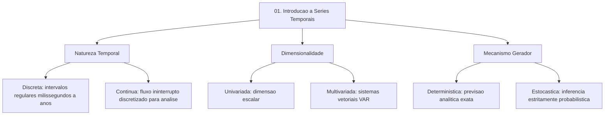
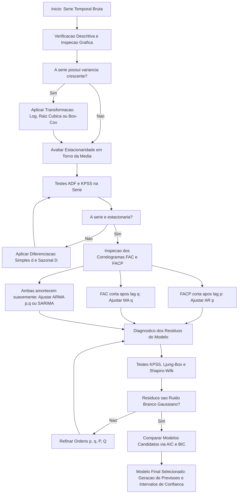

## Séries Temporais: Guia Completo e Notas de Estudo Aprofundadas por Arquivo

Este documento organiza detalhadamente todos os 31 arquivos de apoio, notas de aula, slides teóricos, notebooks práticos em Python e scripts em R sobre Séries Temporais, integrando teoria estatística rigorosa, formulações matemáticas, resolução exaustiva de exercícios e conexões práticas com Inteligência Artificial e Machine Learning.

---

### 1. `01 - introducao a series temporais.pdf`: Introdução Conceitual às Séries Temporais

- Definição Formal e Mecanismo Gerador: Uma série temporal é uma coleção ordenada de variáveis aleatórias observadas ao longo do tempo em intervalos pré-fixados e equi-espaçados:
  $$Z = \{Z_t : t \in T\}, \quad \text{com } T = \{1, 2, \dots, n\}$$
  A premissa fundamental que distingue as séries temporais da estatística clássica reside na dependência serial temporal (autocorrelação). Os dados não são independentes nem identicamente distribuídos (i.i.d.); a permutação de pontos destrói a estrutura probabilística subjacente.
- Definição Clássica e Conceitual: Uma série observada no mundo real representa uma trajetória amostral única ou uma realização finita de um processo estocástico subjacente.
- Classificação Estrutural de Séries Temporais:
  - Discretas versus Contínuas:
    - Séries Discretas: As observações ocorrem em instantes específicos e regulares (milissegundos, minutos, horas, dias, meses, trimestres ou anos).
    - Séries Contínuas: O registro ocorre em fluxo ininterrupto contínuo (por exemplo, monitoramento analógico contínuo de temperatura ou sinais de eletrocardiograma).
    - Princípio da Discretização Operacional: Na prática computacional e em modelagem estatística, séries contínuas são invariavelmente discretizadas por taxas de amostragem uniformes.
  - Univariadas versus Multivariadas:
    - Univariadas: Registram a evolução de uma única variável escalar $Z_t \in \mathbb{R}$.
    - Multivariadas: Monitoram vetores multidimensionais $Z_t = [Z_{1t}, Z_{2t}, \dots, Z_{kt}]^T \in \mathbb{R}^k$, modelando dependências mútuas e defasadas entre múltiplos canais.
  - Determinísticas versus Estocásticas:
    - Determinísticas: O comportamento futuro pode ser previsto com precisão absoluta através de uma função matemática analítica fechada, sem qualquer termo residual probabilístico.
    - Estocásticas: Os valores futuros só podem ser inferidos probabilisticamente, uma vez que o fenômeno incorpora uma componente aleatória intrínseca.
- Objetivos Analíticos e Mercadológicos:
  - Compreender os mecanismos físicos ou de negócio que geram a série.
  - Decompor e quantificar as dinâmicas de tendência, sazonalidade e ciclo.
  - Realizar projeções e previsões em horizontes de curto, médio e longo prazo.
  - Detectar anomalias e quebras estruturais em processos industriais e financeiros.
- Insights / Conexão com IA/ML: Em aprendizado de máquina supervisionado para séries temporais, a hipótese de amostras i.i.d. é inválida. Técnicas de validação cruzada tradicionais (K-Fold aleatório) causam vazamento de dados do futuro (data leakage); a validação deve obrigatoriamente respeitar a causalidade temporal através de divisões cronológicas (Time Series Split ou Rolling Origin).

---

### 2. `02 - Fundamentos Series temporais - parte I.pdf`: Fundamentos Probabilísticos e Covariância

- Notação Matemática e Espaço Amostral:
  - A realização de uma série univariada é indicada por $\{Z_1, Z_2, \dots, Z_n\}$ ou $Z_t, t = 1, \dots, n$.
  - Para sistemas bivariados ou multivariados, representa-se como vetor de funções no tempo $Z(t) = [Z_1(t), Z_2(t)]^T$.
- Fundamentos de Processos Estocásticos:
  - Dado um espaço de probabilidade $(\Omega, \mathcal{F}, P)$, um processo estocástico é uma família de variáveis aleatórias indexadas por um conjunto paramétrico $T$: $\{X(t, \omega) : t \in T, \omega \in \Omega\}$.
  - Para um elemento específico $\omega_0$ fixado no espaço amostral, a função resultante $X(t, \omega_0)$ representa uma trajetória particular (realização da série temporal).
  - O conjunto dos valores assumidos pelas variáveis aleatórias $Z(t)$ constitui o espaço de estados do processo (discreto ou contínuo).
- Covariância Temporal e Dependência Serial:
  - A covariância afere o grau de interdependência linear entre variáveis aleatórias defasadas por um intervalo $\Delta t = k$:
    $$\operatorname{Cov}(Z_t, Z_{t+k}) = \frac{1}{n^*} \sum_{t=1}^{n^*} (Z_t - \bar{Z}_t)(Z_{t+k} - \bar{Z}_{t+k})$$
    Onde $n^*$ é a quantidade de pares contíguos comparados no lag $k$. Em séries temporais reais, observações vizinhas frequentemente apresentam forte correlação serial positiva ou negativa.
- Resolução Detalhada do Exercício de Covariância Temporal (Slides Parte I):
  - Enunciado do Material: Dada a série histórica de vendas em 5 meses consecutivos: Janeiro = 20, Fevereiro = 30, Março = 40, Abril = 50 e Maio = 60. Calcular a covariância temporal para intervalo unitário (lag 1, $\Delta t = 1$).
  - Passo 1: Estruturação dos pares ordenados contíguos $(Z_t, Z_{t+1})$:
    - Par 1: $t = \text{Janeiro} \implies Z_t = 20$; $t+1 = \text{Fevereiro} \implies Z_{t+1} = 30$.
    - Par 2: $t = \text{Fevereiro} \implies Z_t = 30$; $t+1 = \text{Março} \implies Z_{t+1} = 40$.
    - Par 3: $t = \text{Março} \implies Z_t = 40$; $t+1 = \text{Abril} \implies Z_{t+1} = 50$.
    - Par 4: $t = \text{Abril} \implies Z_t = 50$; $t+1 = \text{Maio} \implies Z_{t+1} = 60$.
    - O mês de Maio não possui sucessor $t+1$, resultando em $n^* = 4$ pares válidos.
  - Passo 2: Cálculo das médias aritméticas dos blocos emparelhados:
    $$\bar{Z}_t = \frac{20 + 30 + 40 + 50}{4} = \frac{140}{4} = 35$$
    $$\bar{Z}_{t+1} = \frac{30 + 40 + 50 + 60}{4} = \frac{180}{4} = 45$$
  - Passo 3: Apuração dos desvios em relação à média e produtos cruzados:
    - Janeiro: $(20 - 35) = -15$; $(30 - 45) = -15$. Produto: $(-15) \times (-15) = 225$.
    - Fevereiro: $(30 - 35) = -5$; $(40 - 45) = -5$. Produto: $(-5) \times (-5) = 25$.
    - Março: $(40 - 35) = +5$; $(50 - 45) = +5$. Produto: $(+5) \times (+5) = 25$.
    - Abril: $(50 - 35) = +15$; $(60 - 45) = +15$. Produto: $(+15) \times (+15) = 225$.
  - Passo 4: Somatório dos desvios cruzados:
    $$\sum_{t=1}^4 (Z_t - \bar{Z}_t)(Z_{t+1} - \bar{Z}_{t+1}) = 225 + 25 + 25 + 225 = 500$$
  - Passo 5: Cálculo da autocovariância amostral média:
    $$\operatorname{Cov}(Z_t, Z_{t+1}) = \frac{500}{4} = 125$$
  - Conclusão Estatística: O resultado $\operatorname{Cov} = 125 > 0$ indica uma forte inércia de crescimento linear monotônico entre períodos contíguos na série de vendas.
- Insights / Conexão com IA/ML: Matrizes de covariância defasada no domínio temporal fornecem os pesos analíticos iniciais para algoritmos de aprendizado de representação em grafos dinâmicos e camadas convolucionais 1D (TCN - Temporal Convolutional Networks).

---

### 3. `03 - Fundamentos Series Temporais - parte II.pdf`: Estacionaridade, Ruído Branco e Passeio Aleatório

- Definição Rigorosa de Estacionaridade:
  - Séries Estacionárias: Desenvolvem-se de maneira aleatória ao longo do tempo oscilando ao redor de uma média constante $\mu(t) = \mu$. A dispersão (variância) e a estrutura de autocovariância são invariantes em relação a translações temporais puras.
  - Séries Não Estacionárias: Exibem variações estruturais contínuas de nível, inclinação ou variância exponencial, degradando a confiabilidade de previsões analíticas.
- Condições de Estacionaridade Fraca (Segunda Ordem):
  - Média invariante no tempo: $E[Z(t)] = \mu, \forall t$.
  - Segundo momento finito e variância constante: $E[Z^2(t)] < \infty \implies \operatorname{Var}(Z_t) = \sigma^2, \forall t$.
  - Autocovariância dependente unicamente do atraso temporal $|s - t| = k$:
    $$\gamma(k) = \operatorname{Cov}(Z_t, Z_{t+k}) = E[(Z_t - \mu)(Z_{t+k} - \mu)]$$
- Ruído Branco (White Noise):
  - Um processo $\{\epsilon_t\}$ é denominado ruído branco se é composto por variáveis aleatórias independentes e identicamente distribuídas com média nula, variância constante e autocorrelações nulas para qualquer defasagem não nula:
    $$E[\epsilon_t] = 0, \quad \operatorname{Var}(\epsilon_t) = \sigma_\epsilon^2, \quad \operatorname{Cov}(\epsilon_t, \epsilon_s) = 0 \quad (\forall t \neq s)$$
    Sob normalidade, $\epsilon_t \sim N(0, \sigma_\epsilon^2)$ define o Ruído Branco Gaussiano, referência analítica ideal para resíduos de modelos preditivos bem calibrados.
- Passeio Aleatório (Random Walk):
  - Modelo Estrutural: $X_t = X_{t-1} + \epsilon_t$, com $X_0 = 0$ e $\epsilon_t$ ruído branco.
  - Expansão por Recorrência: $X_t = \sum_{i=1}^t \epsilon_i$.
  - Média: $E[X_t] = 0$.
  - Variância: $\operatorname{Var}(X_t) = \sum_{i=1}^t \operatorname{Var}(\epsilon_i) = t \sigma_\epsilon^2$. A variância cresce linearmente com $t$, tendendo ao infinito conforme o tempo avança.
  - Covariância: $\operatorname{Cov}(X_t, X_{t+k}) = t \sigma_\epsilon^2$, comprovando que o processo não é estacionário e depende do instante absoluto $t$.
  - Aplicações: Base da teoria de precificação de ativos e eficiência de mercado (Bolsa de Valores e movimento browniano).
- Função de Autocorrelação (FAC / ACF):
  - Normalização da autocovariância pelo produto dos desvios padrão:
    $$\rho(k) = \frac{\gamma(k)}{\gamma(0)} = \frac{\operatorname{Cov}(Z_t, Z_{t+k})}{\operatorname{Var}(Z_t)}$$
    Onde $\rho(0) = 1$ e $-1 \le \rho(k) \le 1$. Em séries estacionárias, a FAC decai rapidamente para o limite estatístico de não significância; em séries com tendência não estacionária, exibe decaimento quase linear e persistente.
- Insights / Conexão com IA/ML: Se um modelo preditivo de Machine Learning gera resíduos autocorrelacionados, significa que existe sinal explicativo desperdiçado que não foi capturado pelas hipóteses do modelo. Apenas quando os resíduos se tornam ruído branco atinge-se o limite de Bayes.

---

### 4. `04 -  Decomposicao serie temporal - parte i.pdf`: Fundamentos da Decomposição Estrutural

- Os Quatro Componentes Fundamentais da Série Temporal:
  - Tendência ($T_t$): Movimento subjacente de evolução a longo prazo da série (crescimento ou decrescimento), não necessitando ser necessariamente linear.
  - Sazonalidade ($S_t$): Padrões repetitivos e oscilatórios que ocorrem em períodos de tempo perfeitamente regulares e conhecidos (por exemplo, ciclos diários, semanais, mensais ou anuais).
  - Ciclo ($C_t$): Variações ondulatórias de média ou longa duração associadas a conjunturas macroeconômicas ou oscilações climáticas, desprovidas de frequência de repetição fixa.
  - Erro Aleatório / Ruído ($R_t$): Termo estocástico residual que representa todas as flutuações irregulares que não são explicadas pela tendência nem pela sazonalidade.
- Exemplos de Múltiplas Sazonalidades Sobrepostas:
  - No consumo de energia de um campus universitário: sazonalidade diária (consumo noturno versus diurno), semanal (dias úteis versus finais de semana) e anual/mensal (período letivo versus férias escolares).
- Modelos Clássicos de Decomposição:
  - Decomposição Aditiva:
    $$Y_t = T_t + S_t + R_t$$
    Apropriada quando a amplitude da oscilação sazonal não se expande com o aumento do nível médio da tendência ao longo dos anos.
  - Decomposição Multiplicativa:
    $$Y_t = T_t \times S_t \times R_t$$
    Apropriada quando a amplitude da variação sazonal e a dispersão aumentam proporcionalmente com o nível da série.
- Métodos de Isolamento e Ajuste de Componentes:
  - Ajuste de Tendência: Subtrai-se $T_t$ (no caso aditivo: $Y_t - T_t = S_t + R_t$) ou divide-se por $T_t$ (no caso multiplicativo: $Y_t / T_t = S_t \times R_t$).
  - Desazonalização (Ajuste Sazonal): Subtrai-se $S_t$ (aditivo: $Y_t - S_t = T_t + R_t$) ou divide-se por $S_t$ (multiplicativo: $Y_t / S_t = T_t \times R_t$).
- Insights / Conexão com IA/ML: Em arquiteturas de ponta para previsão como N-BEATS e Autoformer, blocos neurais especializados realizam decomposição interna iterativa de tendência e sazonalidade para desacoplar as dinâmicas temporais antes do mecanismo de atenção.

---

### 5. `05 - Decomposicao serie temporal - parte ii.pdf`: Métodos de Extração de Tendência e Médias Móveis

- Abordagens para Extração de Tendência:
  - Função Linear Paramétrica: $T_t = a + b t + e_t$, ajustada por Mínimos Quadrados Ordinários (MQO).
  - Função Polinomial: $T_t = \beta_0 + \beta_1 t + \beta_2 t^2 + \dots + \beta_q t^q + e_t$, capaz de modelar pontos de inflexão na evolução histórica.
  - Suavização por Médias Móveis: Filtro não paramétrico que atua eliminando variações de alta frequência e neutralizando oscilações sazonais.
- Tipologias de Médias Móveis:
  - Média Móvel Simples de Valores Passados (MMS Unilateral): Média calculada exclusivamente sobre os $q$ períodos imediatamente anteriores:
    $$\operatorname{MMS}_q(t) = \frac{1}{q} \sum_{i=0}^{q-1} Z_{t-i}$$
    Utilizada para monitoramento online em tempo real, sujeita a defasagem temporal de fase.
  - Média Móvel Simples Centralizada (Simétrica): Média calculada centrando a janela temporal ao redor do instante $t$:
    - Para $q$ ímpar ($q = 2k + 1$):
      $$\operatorname{MMS}_q(t) = \frac{1}{q} \sum_{j=-k}^k Z_{t+j}$$
    - Para $q$ par (ex.: $q = 12$ para dados mensais): Aplica-se média móvel de ordem $2 \times 12$ para garantir a centralização no instante exato:
      $$\operatorname{SMA}_{2\times 12}(t) = \frac{1}{24} Z_{t-6} + \frac{1}{12} \sum_{j=-5}^5 Z_{t+j} + \frac{1}{24} Z_{t+6}$$
      Neutraliza integralmente o padrão sazonal de 12 meses.
  - Média Móvel Exponencial (MME / EMA): Atribui pesos exponencialmente decrescentes às observações passadas:
    $$\operatorname{MME}_t = \alpha Z_t + (1 - \alpha) \operatorname{MME}_{t-1}, \quad \text{onde } 0 < \alpha \le 1$$
    Confere maior relevância às informações mais recentes, reagindo com agilidade a mudanças de regime.
- Insights / Conexão com IA/ML: Indicadores de Médias Móveis Exponenciais e Simples constituem as features de momentum e reversão à média mais exploradas em estratégias quantitativas algorítmicas de negociação financeira e robôs investidores.

---

### 6. `06 - Transformacao e diferenciacao de series.pdf`: Transformações Matemáticas e Operadores de Diferenciação

- Objetivos do Pré-Processamento: Estabilizar a variância condicional da série temporal, transformar sua densidade marginal em aproximadamente Gaussiana e remover dependências determinísticas ou estocásticas de nível e inclinação.
- Família de Transformações de Variância:
  - Transformação Logarítmica: $Z_t^* = \ln(Z_t)$. Recomendada para séries cuja variabilidade se expande proporcionalmente ao nível médio. Exige valores estritamente positivos ($Z_t > 0$).
  - Transformação por Raiz Cúbica: $Z_t^* = (Z_t)^{1/3}$. Indicada para amenizar assimetrias moderadas sem inviabilizar o processamento de registros nulos ou negativos.
  - Transformação de Box-Cox: Ajusta um parâmetro contínuo ótimo $\lambda$:
    $$Z_t^{(\lambda)} = \begin{cases} \frac{Z_t^\lambda - 1}{\lambda}, & \text{se } \lambda \neq 0 \\ \ln(Z_t), & \text{se } \lambda = 0 \end{cases}$$
- Diferenciação para Estabilização da Média:
  - Diferenciação de Primeira Ordem ($d=1$): Operador diferença retroativa $\nabla = (1 - B)$:
    $$\nabla Z_t = Z_t - Z_{t-1}$$
    Converte séries integradas de ordem 1, $I(1)$, como o passeio aleatório, em processos estacionários $I(0)$.
  - Diferenciação Sazonal ($D=1$ com período $s$): Operador diferença sazonal $\nabla_s = (1 - B^s)$:
    $$\nabla_s Z_t = Z_t - Z_{t-s}$$
    Remove ciclos periódicos sistemáticos de passo $s$.
  - Log-Retornos (Retornos Financeiros): Aplicação da primeira diferença sobre a escala logarítmica:
    $$R_t = \ln(Z_t) - \ln(Z_{t-1}) = \ln\left(\frac{Z_t}{Z_{t-1}}\right)$$
- Insights / Conexão com IA/ML: Em séries financeiras e de volume de transações, a taxa percentual de crescimento e os log-retornos são a transformação canônica para treinar modelos preditivos supervisionados, garantindo variáveis estacionárias com distribuição próxima à normal.

---

### 7. `07 - Modelos de séries temporais - parte i.pdf`: Modelos Paramétricos AR($p$) e MA($q$)

- Visão Taxonômica dos Modelos de Séries Temporais:
  - Modelos Paramétricos: Regressão linear temporal, metodologia Box-Jenkins (ARIMA, SARIMA), modelos de memória longa (ARFIMA) e modelos não lineares (ARCH, GARCH, redes neurais).
  - Modelos Não Paramétricos: Transformada de Fourier, análise espectral e autocovariâncias empíricas.
- Modelos Autorregressivos - AR($p$):
  - Equação Estrutural: A variável $X_t$ é explicada linearmente por seus próprios $p$ valores passados acrescidos de uma constante $c$ e um choque aleatório ruído branco $\epsilon_t$:
    $$X_t = c + \sum_{i=1}^p \phi_i X_{t-i} + \epsilon_t = c + \phi_1 X_{t-1} + \dots + \phi_p X_{t-p} + \epsilon_t$$
  - Condição de Estacionaridade: As raízes do polinômio característico $\Phi(B) = 1 - \sum_{i=1}^p \phi_i B^i = 0$ devem repousar estritamente fora do círculo unitário complexo ($|B| > 1$). Para um processo AR(1), isto reduz-se a $|\phi_1| < 1$.
  - Identificação via Gráficos de Autocorrelação:
    - FAC (ACF): Decaimento suave exponencial ou senoidal amortecido.
    - FACP (PACF): Apresenta corte abrupto para zero imediatamente após o lag $p$.
- Modelos de Médias Móveis - MA($q$):
  - Equação Estrutural: A variável $X_t$ é descrita em função de uma média global constante $\mu$ e dos $q$ choques aleatórios defasados:
    $$X_t = \mu + \epsilon_t + \sum_{j=1}^q \theta_j \epsilon_{t-j} = \mu + \epsilon_t + \theta_1 \epsilon_{t-1} + \dots + \theta_q \epsilon_{t-q}$$
  - Condição de Invertibilidade: As raízes de $\Theta(B) = 1 + \sum_{j=1}^q \theta_j B^j = 0$ devem situar-se fora do círculo unitário, assegurando equivalência funcional a uma representação AR($\infty$) convergente.
  - Identificação via Gráficos de Autocorrelação:
    - FAC (ACF): Apresenta corte abrupto para zero imediatamente após o lag $q$.
    - FACP (PACF): Decaimento suave amortecido para zero.
- Insights / Conexão com IA/ML: O processo AR($p$) é o análogo temporal exato de uma regressão linear múltipla onde os preditores são variáveis defasadas da própria variável dependente. O operador MA($q$) modela a resposta ao impulso e a absorção de choques exógenos inesperados.

---

### 8. `08 - Modelos de Séries Temporais - parte II.pdf`: Modelos ARMA($p, q$), ARIMA($p, d, q$) e SARIMA

- Modelos ARMA($p, q$):
  - Formulação: Combinação integrada de $p$ termos autorregressivos e $q$ termos de médias móveis:
    $$\Phi_p(B) X_t = c + \Theta_q(B) \epsilon_t$$
  - Princípio da Parcimônia Estatística: Um modelo ARMA($1,1$) com apenas dois coeficientes dinâmicos modela com frequência estruturas de dependência que demandariam um AR(4) ou MA(4) com múltiplos parâmetros livres.
- Modelos ARIMA($p, d, q$):
  - Definição: Aplicação do modelo ARMA($p,q$) sobre a $d$-ésima diferença da série não estacionária $X_t$:
    $$\Phi_p(B)(1 - B)^d X_t = c + \Theta_q(B) \epsilon_t$$
  - Significado dos Parâmetros:
    - $p$: Número de termos autorregressivos.
    - $d$: Grau de diferenciação simples para anular tendências.
    - $q$: Número de termos de médias móveis de choques aleatórios.
- Modelos SARIMA:
  - Extensão para Sazonalidade: SARIMA($p, d, q$) $\times$ ($P, D, Q$)$_s$:
    $$\Phi_p(B) \tilde{\Phi}_P(B^s) (1 - B)^d (1 - B^s)^D X_t = c + \Theta_q(B) \tilde{\Theta}_Q(B^s) \epsilon_t$$
    Onde $P$ é o grau autorregressivo sazonal, $D$ é a ordem da diferenciação sazonal, $Q$ é a ordem da média móvel sazonal e $s$ é o período do ciclo sazonal.
- Tabela Sintética de Identificação Box-Jenkins:

| Modelo Estacionário   | Comportamento da FAC (ACF)                  | Comportamento da FACP (PACF)                |
| :-------------------- | :------------------------------------------ | :------------------------------------------ |
| **AR($p$)**           | Decai exponencialmente ou oscila amortecido | Corte abrupto após o lag $p$                |
| **MA($q$)**           | Corte abrupto após o lag $q$                | Decai exponencialmente ou oscila amortecido |
| **ARMA($p, q$)**      | Decai amortecido a partir do lag $q$        | Decai amortecido a partir do lag $p$        |
| **Passeio Aleatório** | Decaimento linear excessivamente lento      | Pico único no lag 1 e corte posterior       |

- Insights / Conexão com IA/ML: SARIMA representa o baseline clássico obrigatório contra o qual qualquer modelo moderno baseado em redes neurais ou ensembles (XGBoost, Prophet, DeepAR) deve ser comparado para justificar sua complexidade operacional.

---

### 9. `01 - Introdução a séries temporais - Decomposição.Rmd`: Análise Descritiva e Decomposição Clássica em R

- Bibliotecas Utilizadas: `ggfortify`, `tseries`, `forecast`.
- Carga de Dados e Inspeção: Conjunto `AirPassengers` (classe nativa `ts`, frequência 12, período 1949 a 1960).
- Comandos Analíticos em R:
  - `class(AP)`: Confirma a classe de série temporal univariada.
  - `sum(is.na(AP))`: Valida a ausência de registros faltantes.
  - `frequency(AP)`: Retorna 12 (série mensal).
  - `cycle(AP)`: Mapeia o índice ordinal de cada mês do ciclo anual.
- Decomposição Clássica:
  - `decompose(AP, type = "additive")` e `decompose(AP, type = "multiplicative")`.
  - Critério de Avaliação: Inspeção do componente aleatório residual. A decomposição aditiva deixa resquícios evidentes de sazonalidade e variância residual crescente no final da série, enquanto a multiplicativa produz resíduos estritamente aleatórios e homocedásticos.
- Ajuste Manual de Tendência:
  - Ajuste linear: `lm(AP ~ time(AP))`.
  - Ajuste polinomial: `lm(AP ~ poly(time(AP), 2))` e grau 6.
  - Médias móveis manuais: `stats::filter(AP, rep(1/6, 6), sides = 1)` (unilateral) e `stats::filter(AP, rep(1/13, 13), sides = 2)` (simétrica centralizada).
- Insights / Conexão com IA/ML: No desenvolvimento de pipelines de inferência, verificar o comportamento dos resíduos da decomposição serve como teste unitário estatístico antes do envio das séries aos modelos de produção.

---

### 10. `02 - Introdução a séries temporais - Decomposição.Rmd`: Refinamento de Decomposição e Análise Descritiva

- Aprofundamento do RMD Anterior: Estruturação modularizada com documentação detalhada da base `AirPassengers` e das premissas de consistência dos dados.
- Exploração do Dataset `Nile`:
  - Aplicação de ajustes polinomiais de ordem 2 e ordem 6 sobre o histórico anual do Rio Nilo, demonstrando como polinômios de ordem elevada sofrem de sobreajuste (overfitting) nas extremidades amostrais (fenômeno de Runge).
- Análise de Parâmetros de Filtros:
  - O parâmetro `sides = 1` utiliza apenas observações passadas, sendo adequado para filtros causais em produção.
  - O parâmetro `sides = 2` realiza a média centrada no tempo presente, exigindo dados futuros e servindo apenas para análise histórica retrospectiva.
- Insights / Conexão com IA/ML: O trade-off entre filtros causais (`sides=1`) e simétricos (`sides=2`) é idêntico ao dilema enfrentado em modelos de linguagem e séries temporais com atenção mascarada (causal masking) versus autoencoders bidirecionais (BERT).

---

### 11. `03 - Introdução a Séries Temporais e decomposição.ipynb`: Criação e Manipulação de Séries em Python

- Bibliotecas Fundamentais: `pandas`, `numpy`, `matplotlib`, `statsmodels.tsa.seasonal.seasonal_decompose`.
- Construção de Séries Temporais em Python com Diferentes Frequências:
  - Série Anual: `pd.date_range('1980', periods = n, freq = 'Y')`.
  - Série Mensal: `pd.date_range(start='2015-01', periods = 96, freq = 'M')` ou manipulação via `np.datetime64`.
  - Série Diária: `pd.date_range('2019 Jan 1', periods = n, freq = 'D')`.
  - Série Trimestral: `pd.date_range('1980-01', periods = n, freq = '3M')` ou `'Q'`.
- Simulação de Série Artificial com Componentes Sintéticos:
  - Criação programática de uma tendência linear determinística ($0.05   imes t$), sazonalidade senoidal periódica ($10   imes \sin(2\pi t / 30)$) e ruído Gaussiano puro ($\epsilon_t \sim N(0, 1)$).
  - Aplicação do algoritmo `seasonal_decompose` para validar a recuperação dos componentes sintéticos inseridos no processo gerador.
- Estudo Prático com o Dataset `flights` do Seaborn:
  - Conversão de colunas `year` e `month` em índice temporal `pd.DatetimeIndex`.
  - Execução e comparação direta dos modelos aditivo e multiplicativo de `seasonal_decompose`.
- Insights / Conexão com IA/ML: O domínio de manipulação de timestamps, reamostragem (`resample`), preenchimento de lacunas (`ffill`, `bfill`) e indexação temporal no Pandas é o pré-requisito elementar para qualquer esteira de engenharia de dados em Machine Learning.

---

### 12. `04 - Transformacao e diferenciacao de series temporais.ipynb`: Pré-processamento Prático em Python

- Fluxo Completo de Pré-Processamento:
  - Carga da série temporal de volume de passageiros.
  - Aplicação de transformações de dispersão: transformação por logaritmo natural (`np.log(df)`) e transformação por raiz cúbica (`np.cbrt(df)`).
  - Avaliação gráfica de simetria e gráficos de probabilidade normal (QQ-plot).
- Operações de Diferenciação Simples e Sazonal:
  - Primeira diferença para remoção de tendência: `df.diff(1).dropna()`.
  - Diferenciação sazonal para remoção de padrão mensal de período 12: `df.diff(12).dropna()`.
  - Diferenciação mista (tendência + sazonalidade): `df.diff(1).diff(12).dropna()`.
- Algoritmos de Reversão Matemática:
  - Reversão de logaritmo: `np.exp(df_log)`.
  - Reversão de raiz cúbica: `np.power(df_cbrt, 3)`.
  - Reversão de diferenciação simples: utilização da soma cumulativa aplicada ao nível anterior da série: `Z_0 + df_diff.cumsum()`.
- Insights / Conexão com IA/ML: Em arquiteturas de redes neurais artificiais, o pré-processamento via log-retornos e diferenciação é vital para evitar gradientes explosivos ou nulos provocados por séries não estacionárias sem escala delimitada.

---

### 13. `05 - Transformacao e diferenciacao com R.Rmd`: Transformação, Testes KPSS/ADF e Reversão em R

- Implementação Completa em Linguagem R:
  - Inspeção visual de normalidade através de `qqnorm()` e `qqline()`.
  - Transformação logarítmica: `log(x)`.
  - Transformação logarítmica de base 10: `log10(x)`.
  - Transformação por raiz cúbica: `sign(x) * (abs(x))^(1/3)`.
- Testes Formais de Estacionaridade no Pipeline:
  - Teste KPSS (`ur.kpss(x)` do pacote `urca`): Avalia a presença de raiz unitária na série original e transformada.
  - Teste ADF (`adf.test(x)` do pacote `tseries`): Confirma a rejeição de não estacionaridade após diferenciações sucessivas.
- Implementação de Reversão Exata em R:
  - Reversão de logaritmo: `exp(x_log)`.
  - Reversão de log10: `10^(x_log10)`.
  - Reversão de diferenciação com vetor reconstruído via `diffinv()`:
    $$\operatorname{diffinv}(w,   ext{differences} = 1,   ext{xi} = x_1)$$
- Insights / Conexão com IA/ML: A função `diffinv` garante preservação exata da condição de contorno original no processo de inferência reversa, indispensável ao disponibilizar saídas em APIs de previsão.

---

### 14. `06 - Correlograma e Teste de estacionaridade.ipynb`: Correlogramas, Testes Formais e Estudo CO2

- Diagnóstico de Estacionaridade via Simulação Computacional:
  - Simulação de Ruído Branco Gaussiano: `np.random.normal(0, 1, 1000)`. Teste KPSS confirma estacionaridade estrita ($p  ext{-valor} = 0.10$).
  - Simulação de Processo AR(1) com persistência positiva ($X_t = 0.8 X_{t-1} + \epsilon_t$): FAC decai de forma suave e amortecida; FACP exibe corte após lag 1; KPSS falha em rejeitar estacionaridade.
  - Simulação de Processo AR(1) com oscilação negativa ($X_t = -0.8 X_{t-1} + \epsilon_t$): FAC alterna sinais a cada lag; FACP apresenta corte negativo no lag 1.
  - Simulação de Passeio Aleatório ($X_t = X_{t-1} + \epsilon_t$): FAC com decaimento excessivamente lento; teste KPSS rejeita estacionaridade ($p  ext{-valor} \le 0.01$).
- Resolução Detalhada do Exercício do CO2 Atmosférico:
  - Enunciado: Carregar a base de dados de medições semanais/mensais de CO2 atmosférico de Mauna Loa (`statsmodels.datasets.co2`), preencher observações ausentes com `ffill()`, traçar gráficos temporais e correlogramas, executar testes de hipóteses de estacionaridade e definir a estratégia de diferenciação necessária.
  - Passo 1: Carregamento dos dados e inspeção gráfica. A série temporal exibe tendência ascendente monotônica evidente e padrão sazonal com período de repetição anual.
  - Passo 2: Correlograma da série bruta. A FAC inicia com autocorrelação próxima de 1.0 e decai de maneira linear extremamente lenta, indicativo de forte não estacionaridade.
  - Passo 3: Execução do teste KPSS sobre a série bruta: Estatística do teste de 1.6513 (valor crítico de 1% = 0.7390, $p  ext{-valor} \le 0.01$). Rejeita-se categoricamente a hipótese nula de estacionaridade.
  - Passo 4: Execução do teste ADF sobre a série bruta: Estatística calculada de -0.7054 ($p  ext{-valor} = 0.8453$). Falha ao rejeitar a presença de raiz unitária.
  - Passo 5: Aplicação da primeira diferença não sazonal: A série passa a oscilar em torno de zero, mas a FAC revela fortes correlações periódicas nos múltiplos sazonais (lags 12, 24, 36).
  - Passo 6: Aplicação da diferença sazonal adicional ($D=1, s=12$): O teste ADF sobre a série duplamente diferenciada alcança $p  ext{-valor} < 0.001$ e o teste KPSS atinge $p  ext{-valor} = 0.10$.
  - Conclusão do Exercício: A série de CO2 exige simultaneamente $d=1$ e $D=1$ para atingir a estacionaridade estrita requerida pela modelagem SARIMA.
- Insights / Conexão com IA/ML: Identificar se uma série possui raiz unitária estocástica (eliminada com diferenciação) ou tendência determinística (eliminada com regressão linear) evita a ocorrência de regressões espúrias em algoritmos de Machine Learning.

---

### 15. `07 - Autocorrelacao(FAC) e teste de estacionaridade.Rmd`: Autocorrelação e Testes Formais em R

- Scripts e Metodologia em R:
  - Configuração de correlogramas com as funções nativas `acf()` e `pacf()`.
  - Simulações comparativas de Ruído Branco, AR(1) positivo ($\phi = 0.8$), AR(1) negativo ($\phi = -0.8$) e Passeio Aleatório.
- Detalhamento do Teste KPSS em R via Pacotes `tseries` e `urca`:
  - `kpss.test(x, null = "Level")` e `kpss.test(x, null = "Trend")`.
  - Avaliação dos intervalos críticos tabelados (10%, 5%, 2.5%, 1%).
- Interpretação das Faixas de Significância Estatística nos Correlogramas:
  - Limiares críticos de Bartlett dados por $\pm 1.96 / \sqrt{n}$. Lags cuja autocorrelação ultrapassa essas linhas tracejadas são significativamente diferentes de zero ao nível de confiança de 95%.
- Insights / Conexão com IA/ML: Os limiares de significância de Bartlett estabelecem o critério probabilístico para selecionar automaticamente a quantidade de lags que entram como variáveis explicativas em modelos de regressão linear regularizada (Lasso/Ridge).

---

### 16. `2 - Correlograma e Teste de estacionaridade.ipynb`: Caderno Complementar de Correlogramas

- Estrutura e Conteúdo: Versão focada nas etapas computacionais do diagnóstico de dependência temporal em Python.
- Simulação de Processos Estocásticos Paradigmáticos:
  - Comparação lado a lado de trajetórias e correlogramas de processos ruído branco, processos autorregressivos de memória curta e passeios aleatórios integrados.
- Análise de Erros de Amostragem em Amostras Pequenas:
  - Demonstração prática de que em séries com menos de 100 observações, a variabilidade amostral pode produzir falsas autocorrelações parciais que não existem no processo gerador verdadeiro, enfatizando a importância do critério de parcimônia.
- Insights / Conexão com IA/ML: Para mitigar flutuações amostrais espúrias em amostras reduzidas, modelos de Machine Learning devem adotar regularização L1 (Lasso) ou prioris bayesianas para zerar coeficientes sem sustentação estatística.

---

### 17. `AirPassengers.csv`: Conjunto de Dados de Passageiros de Companhia Aérea

- Estrutura e Granularidade dos Dados:
  - Arquivo no formato CSV contendo 144 observações mensais registradas entre janeiro de 1949 (`1949-01`) e dezembro de 1960 (`1960-12`).
  - Colunas: `Month` (identificador cronológico no formato AAAA-MM) e `Passengers` (contagem de passageiros transportados em milhares).
- Características Estatísticas Fundamentais:
  - Presença de tendência secular ascendente contínua (expansão da aviação comercial no pós-guerra).
  - Padrão sazonal multiplicativo nítido de período anual (picos nos meses de férias de verão e finais de ano: julho, agosto e dezembro).
  - Heterocedasticidade evidente: a variância das oscilações anuais amplia-se sistematicamente conforme o nível médio da série se expande de 112 mil passageiros em 1949 para mais de 600 mil em 1960.
- Papel no Curso: Atua como benchmark internacional clássico da literatura de séries temporais para calibração, validação cruzada e comparação de modelos de decomposição e modelos SARIMA.

---

### 18. `Autocorrelacao(FAC) e teste de estacionaridade.Rmd`: Versão Consolidada de Correlograma em R

- Consolidação e Síntese de Diagnósticos em R:
  - Organização unificada das rotinas de cálculo da FAC e da FACP para identificação de ordens $p$ e $q$.
  - Comparação direta das saídas do teste KPSS com hipótese nula de estacionaridade em nível (`null="Level"`) contra hipótese nula de estacionaridade em tendência (`null="Trend"`).
  - Orientações práticas sobre a conduta estatística quando os testes ADF e KPSS produzem conclusões discordantes (caso de raiz unitária versus quebra estrutural determinística).
- Insights / Conexão com IA/ML: Modelos de Deep Learning como LSTMs aplicados a dados não estacionários sofrem com o problema de drift de distribuição de covariáveis (covariate shift), tornando os pesos aprendidos no início do histórico obsoletos ao longo do tempo.

---

### 19. `Modelo ARMA e ARIMA.Rmd`: Simulação, Estacionaridade e Ajuste em R

- Pacotes Utilizados: `forecast`, `tseries`, `urca`.
- Simulação Computacional de Processo ARIMA(1, 1, 1):
  - Geração de série com coeficientes $\phi_1 = 0.6$, $ heta_1 = -0.4$ e primeira diferença $d = 1$: `arima.sim(model = list(order = c(1, 1, 1), ar = 0.6, ma = -0.4), n = 1000)`.
- Determinação do Número de Diferenciações Necessárias:
  - Utilização da função `ndiffs()` do pacote `forecast` para testar formalmente quantas diferenciações $d$ são requeridas até o alcance da estacionaridade.
- Ajuste e Estimação de Parâmetros:
  - Ajuste na série diferenciada via `Arima(w, order = c(1, 0, 1))`.
  - Ajuste direto na série original integrada via `Arima(x, order = c(1, 1, 1))`.
  - Diagnóstico residual com a função `checkresiduals()`: plota resíduos padronizados, correlograma da FAC residual e histograma de densidade com teste de Ljung-Box embutido.
- Insights / Conexão com IA/ML: O pipeline da metodologia Box-Jenkins em R automatizado via `ndiffs` e `auto.arima` inspirou as rotinas de AutoML para séries temporais modernas como as bibliotecas auto-gluon e darts.

---

### 20. `Modelo SARIMA e Previsões.Rmd`: Modelagem Sazonal e Previsões em R

- Aplicação sobre a Série `AirPassengers`:
  - Execução dos testes KPSS e ADF na série original confirmando não estacionaridade em nível.
  - Avaliação do número de diferenciações sazonais via função `nsdiffs(AirPassengers)`: confirma a necessidade de uma diferenciação sazonal ($D = 1, s = 12$).
- Formulação e Ajuste de Modelos Candidatos:
  - Modelo 1: SARIMA(1, 1, 0) $ imes$ (0, 1, 0)$_{12}$.
  - Modelo 2: SARIMA(1, 1, 1) $ imes$ (0, 1, 0)$_{12}$ ou parametrizações com MA sazonal.
- Geração de Previsões e Intervalos de Confiança:
  - Uso da função `forecast(modelo, h = 12, level = 95)` para projetar 1 ano futuro com limites superior e inferior de confiança analítica.
  - Execução de busca automática via `auto.arima(AirPassengers)` e plotagem das projeções resultantes.
- Insights / Conexão com IA/ML: Intervalos de confiança analíticos derivados de modelos estatísticos fornecem os limites de incerteza necessários para compor políticas de controle e aprendizado por reforço seguro (Safe Reinforcement Learning).

---

### 21. `Modelos AR e  MA.Rmd`: Identificação de Processos AR e MA em R

- Análise Detalhada de Processos Autorregressivos de Ordem Superior:
  - Processo AR(2): $X_t = \phi_1 X_{t-1} + \phi_2 X_{t-2} + \epsilon_t$, com $\phi_1 = 0.5$, $\phi_2 = 0.4$. Simulação e verificação de que a FACP apresenta corte nítido após o lag 2.
  - Processo AR(3): Simulação com três defasagens ativas e constatação de corte na FACP após o lag 3.
- Análise de Processos de Médias Móveis MA:
  - Simulação de MA(1) com coeficiente positivo ($ heta = 0.7$) e negativo ($ heta = -0.7$). Constatação de que a FAC exibe corte após lag 1, enquanto a FACP decai de forma amortecida.
- Regra Prática de Decisão Mapeada no R:
  - FACP corta no lag $p \implies$ Modelo AR($p$).
  - FAC corta no lag $q \implies$ Modelo MA($q$).
- Insights / Conexão com IA/ML: Em redes neurais do tipo MLP aplicadas a séries temporais, a quantidade de neurônios na camada de entrada deve corresponder exatamente à ordem autorregressiva $p$ identificada na FACP.

---

### 22. `Modelos AR e MA atualizado.ipynb`: Simulações Aprofundadas de AR e MA em Python

- Bibliotecas Utilizadas: `numpy`, `pandas`, `matplotlib`, `statsmodels.tsa.arima_process.ArmaProcess`.
- Simulação Prática de Processo AR(2):
  - Parâmetros: $\phi_1 = 0.5, \phi_2 = 0.4$, $\epsilon_t \sim N(0, 9)$.
  - Verificação de que a equação característica possui raízes reais fora do círculo unitário, assegurando processo estacionário.
  - Visualização em 3 painéis: série temporal simulada, correlograma da FAC (decaimento gradual) e correlograma da FACP (picos significativos nos lags 1 e 2, corte a partir do lag 3).
- Simulação de Processo AR(3):
  - Inclusão de três coeficientes autorregressivos e constatação visual do corte abrupto na FACP no lag 3.
- Simulação de Processos MA(1) e MA(2):
  - MA(1) com coeficiente positivo ($ heta = 0.6$): pico positivo na FAC no lag 1 e decaimento oscilatório suave na FACP.
  - MA(1) com coeficiente negativo ($ heta = -0.6$): pico negativo na FAC no lag 1.
  - MA(2) ($ heta_1 = 0.5, heta_2 = -0.4$): picos significativos nos lags 1 e 2 da FAC com corte abrupto a partir do lag 3.
- Bateria de Testes KPSS e ADF nos Processos Simulados:
  - Confirmação formal da estacionaridade das séries geradas ($p  ext{-valor} < 0.05$ no ADF e $p  ext{-valor} = 0.10$ no KPSS).
- Insights / Conexão com IA/ML: O conhecimento dos perfis de decaimento e corte da FAC/FACP permite criar algoritmos baseados em regras ou redes convolucionais que diagnosticam automaticamente a ordem ideal de modelos sem intervenção manual.

---

### 23. `Modelos AR e MA.ipynb`: Caderno Base de Modelos Autorregressivos em Python

- Versão Base do Estudo de Processos Autorregressivos e de Médias Móveis:
  - Foco nas equações matemáticas analíticas fundamentais e nas condições de invertibilidade e estacionaridade.
  - Implementação de laços iterativos manuais em Python para geração de séries AR($p$) e MA($q$) comparados à classe `ArmaProcess` do statsmodels.
- Diagnóstico de Resíduos Brutos:
  - Análise dos desvios entre valores observados e valores esperados para checagem da convergência estatística do gerador estocástico.
- Insights / Conexão com IA/ML: Implementar manualmente a equação iterativa de um modelo ARMA em Python reforça a compreensão computacional de como as camadas recorrentes de uma RNN atualizam seu estado oculto ao longo do tempo.

---

### 24. `Modelos ARMA e ARIMA modificado.ipynb`: Modelagem Completa Box-Jenkins em Python

- Simulação de Modelo ARIMA(1, 1, 1):
  - Parâmetros: $\phi_1 = 0.6,   heta_1 = -0.4, d = 1$, tamanho da amostra $n = 1000$.
- Diagnóstico de Estacionaridade na Série Original:
  - Teste KPSS original: Estatística = 4.7594 ($p  ext{-valor} = 0.01$). Rejeita-se a hipótese nula de estacionaridade.
  - Teste ADF original: Estatística = -0.7054 ($p  ext{-valor} = 0.8453$). Falha ao rejeitar a raiz unitária.
- Aplicação da Diferenciação Simples:
  - Obtenção da série diferenciada $w_t = 
abla X_t$.
  - Teste KPSS na série diferenciada: Estatística = 0.0450 ($p  ext{-valor} = 0.10$). Falha ao rejeitar $H_0$ (estacionária).
  - Teste ADF na série diferenciada: Estatística = -9.2992 ($p  ext{-valor} < 0.0001$). Rejeita-se a raiz unitária (estacionária).
- Ajuste e Validação Estatística do Modelo ARMA(1, 1):
  - Ajuste via `statsmodels.tsa.arima.model.ARIMA`. Log Likelihood = -1418.625, AIC = 2845.250, BIC = 2864.877.
  - Teste KPSS nos resíduos: Estatística = 0.0401 ($p  ext{-valor} = 0.10$). Os resíduos são estacionários.
  - Teste Ljung-Box nos resíduos: Confirmação de ausência de autocorrelação residual ($p  ext{-valor} > 0.05$, ruído branco).
  - Teste Shapiro-Wilk: Confirmação de normalidade dos resíduos.
- Comparação de Modelos e Busca Automática via `pmdarima.auto_arima`:
  - Demonstração da busca em grid minimizando o critério de informação de Akaike (AIC).
- Insights / Conexão com IA/ML: Em problemas de previsão em tempo real, modelos ARIMA bem ajustados superam frequentemente redes neurais complexas em horizontes curtos com custo computacional mil vezes menor.

---

### 25. `Modelos ARMA e ARIMA.ipynb`: Caderno Base de Ajuste ARMA/ARIMA em Python

- Implementação Original do Pipeline Box-Jenkins:
  - Funções auxiliares para plotagem simultânea da série temporal, histograma com densidade kernel (KDE), gráfico QQ de normalidade e correlogramas da FAC e da FACP.
- Estudo Comparativo de Modelos Não Integrados vs Integrados:
  - Demonstração de que o ajuste de um modelo ARMA(1,1) diretamente sobre dados não estacionários resulta em coeficientes autorregressivos com raiz unitária aproximada ($\phi_1 \approx 1.0$), invalidando as premissas inferenciais clássicas.
- Insights / Conexão com IA/ML: Redes neurais aplicadas a séries com raiz unitária aprendem correlações espúrias que desaparecem em produção; a diferenciação prévia estabiliza a função de perda durante o treinamento do gradiente descendente.

---

### 26. `Modelos SARIMA e Previsoes ajustado.ipynb`: Estudo Prático Aprofundado de SARIMA em Python

- Carga e Decomposição Multiplicativa de `AirPassengers.csv`:
  - Decomposição evidenciando forte componente de tendência e regime sazonal com ciclo de 12 meses.
- Testes Formais e Determinação das Ordens $d$ e $D$:
  - Teste KPSS na série original: Estatística = 1.6513 ($p  ext{-valor} = 0.01$). Não estacionária.
  - Teste de raiz unitária sazonal confirmando $d = 1$ e $D = 1$ com $s = 12$.
  - Série transformada: $w_t = 
abla 
abla_{12} X_t$. Teste KPSS atesta alcance de estacionaridade plena.
- Ajuste Comparativo de Modelos SARIMA Candidatos:
  - Modelo 1: SARIMA(1, 1, 0) $ imes$ (0, 1, 0)$_{12}$:
    - Coeficiente AR: $\phi_1 = -0.3096$ ($p  ext{-valor} < 0.001$).
    - Critérios: Log Likelihood = -504.684, AIC = 1013.368, BIC = 1019.103.
    - Teste KPSS nos resíduos: Estatística = 0.0968 ($p  ext{-valor} = 0.10$). Resíduos estacionários.
    - Teste Ljung-Box (lag 40): Estatística = 40.66 ($p  ext{-valor} = 0.4412$). Resíduos independentes (ruído branco).
  - Modelo 2: SARIMA(0, 1, 1) $ imes$ (0, 1, 1)$_{12}$ (equivalente a SARIMA(1,1,1)):
    - Coeficiente MA não sazonal: $ heta_1 = -0.3175$ ($p  ext{-valor} < 0.001$).
    - Critérios: Log Likelihood = -457.315, AIC = 920.631, BIC = 928.917.
    - Teste KPSS nos resíduos: Estatística = 0.0803 ($p  ext{-valor} = 0.10$). Resíduos estacionários.
    - Teste Ljung-Box (lag 40): Estatística = 41.38 ($p  ext{-valor} = 0.4101$). Resíduos independentes (ruído branco).
- Seleção e Previsão:
  - O Modelo 2 é selecionado devido à expressiva redução no critério AIC (920.63 contra 1013.37).
  - Projeção para 12 meses à frente com intervalos de confiança de 95% capturando com precisão as oscilações sazonais da demanda de passageiros.
- Insights / Conexão com IA/ML: Os sumários estatísticos gerados fornecem $p$-valores analíticos para cada parâmetro ajustado, permitindo descartar termos estatisticamente irrelevantes, técnica correspondente ao pruning em redes neurais.

---

### 27. `Modelos SARIMA e Previsoes.ipynb`: Caderno Essencial de SARIMA em Python

- Fluxo Conciso de SARIMA:
  - Foco na execução direta do pipeline de diferenciação dupla, ajuste das classes `statsmodels.tsa.statespace.sarimax.SARIMAX` e geração de projeções com método `get_forecast()`.
  - Tratamento de índices de data via `pd.to_datetime` para assegurar regularidade na frequência temporal de projeção.
- Insights / Conexão com IA/ML: Modelos de espaço de estados (SARIMAX) permitem a inclusão de covariáveis exógenas (preditores externos contemporâneos), funcionando como uma ponte entre a análise temporal clássica e a regressão multivariada supervisionada de Machine Learning.

---

### 28. `Transformacao e diferenciacao com R.Rmd`: Caderno de Pré-processamento e Transformações em R

- Detalhamento Adicional do Pipeline em R:
  - Rotinas para estabilização de variância e testes comparativos de normalidade residual.
  - Implementação de funções utilitárias para automação do ciclo de pré-processamento e pós-processamento de previsões em ambientes corporativos de produção.
- Insights / Conexão com IA/ML: A transformação de dados em lote em linguagens funcionais e estatísticas como R garante reprodutibilidade total nos pipelines de MLOps.

---

### 29. `modelo sarima e previsoes - ajsutado.Rmd`: Script R Consolidado de SARIMA e Previsões

- Documento Consolidado de Modelagem SARIMA em R:
  - Integração de todo o pipeline: teste KPSS na série bruta, primeira diferenciação simples, teste KPSS pós-diferenciação, teste de diferenciação sazonal (`nsdiffs`), aplicação da diferença sazonal de passo 12.
  - Ajuste comparativo do Modelo 1 (SARIMA(1,1,0)x(0,1,0)[12]) e Modelo 2 (SARIMA(1,1,1)x(0,1,0)[12]).
  - Diagnóstico residual completo: gráficos de resíduos padronizados, correlograma da FAC residual, teste de estacionaridade KPSS, teste de independência Ljung-Box com graus de liberdade ajustados (`fitdf = 2`) e teste de normalidade de Shapiro-Wilk.
  - Geração de previsões via `predict(modelo, n.ahead = 12)` e via `forecast(modelo, h = 12, level = 95)`.
  - Execução de busca automática via `auto.arima()` e discussão do trade-off de incerteza em intervalos de 95%.
- Insights / Conexão com IA/ML: A parametrização adequada dos graus de liberdade no teste de Ljung-Box (`fitdf = p + q`) é essencial para evitar diagnósticos falsamente otimistas em resíduos de modelos preditivos.

---

### 30. `modelos_autorregressivos  AR e MA  - validados.Rmd`: Validação Estatística de AR e MA em R

- Validação Experimental Completa em R:
  - Simulações detalhadas com `set.seed(123)` para reprodutibilidade estrita.
  - Análise em três gráficos integrados via `grid.arrange()`: gráfico no tempo da série, gráfico de barras da FAC com intervalos de Bartlett ($\pm 1.96/\sqrt{n}$) e gráfico de barras da FACP.
  - Simulações e testes formais para AR(2), AR(3), MA(1) positivo, MA(1) negativo e MA(2).
  - Aplicação simultânea de `ur.kpss()` e `adf.test()` para cada cenário simulado, demonstrando a perfeita consistência entre a teoria de Box-Jenkins e o comportamento empírico das realizações amostrais.
- Insights / Conexão com IA/ML: A simulação sintética de dados estocásticos é a principal ferramenta para estressar e testar a robustez de pipelines de Machine Learning antes de sua implantação em cenários reais com ruído extremo.

---

### 31. `sunspots.csv`: Conjunto de Dados Histórico de Manchas Solares

- Descrição da Base de Dados:
  - Registro clássico de medições de atividade solar (número anual de manchas solares observadas).
  - Estrutura: 2 colunas, contendo índice de contagem sequencial e valores médios de intensidade de manchas solares.
- Padrões Dinâmicos e Relevância Estatística:
  - Série estacionária em nível (oscila em torno de uma média estável), sem tendência secular contínua de crescimento.
  - Exibe forte comportamento cíclico pseudo-periódico de aproximadamente 11 anos (Ciclo Solar de Schwabe), mas sem periodicidade fixa exata (os períodos variam entre 9 e 14 anos).
  - Não pode ser modelada adequadamente por sazonalidade fixa clássica determinística, sendo o exemplo canônico internacional para ajuste de modelos autorregressivos de ordem superior AR($p$) e modelos não lineares (como modelos de limiar autorregressivo - TAR e redes neurais recorrentes).
- Insights / Conexão com IA/ML: Séries cíclicas não sazonais como as manchas solares evidenciam o limite dos métodos lineares tradicionais e justificam o emprego de redes neurais profundas (Transformers e LSTMs), capazes de aprender periodicidades plásticas com transições de fase e variações de ritmo temporal.

---

### 32. Resumo Comparativo e Síntese Metodológica

- Fluxograma Integrado de Modelagem de Séries Temporais:

- Quadro Integrativo dos 31 Arquivos e seu Papel Pedagógico:

| Categoria                         | Arquivos Analisados                                                                                                                                                                    | Foco Técnico e Conteúdo Principal                                                                                                                                                                                                                                                                                                                                                                                                   |
| :-------------------------------- | :------------------------------------------------------------------------------------------------------------------------------------------------------------------------------------- | :---------------------------------------------------------------------------------------------------------------------------------------------------------------------------------------------------------------------------------------------------------------------------------------------------------------------------------------------------------------------------------------------------------------------------------- |
| **Fundamentos Teóricos e Slides** | `01`, `02`, `03`, `04`, `05`, `06`, `07`, `08` (.pdf)                                                                                                                                  | Conceituação de séries temporais, processos estocásticos, covariância temporal, cálculo manual de autocovariância (resolvido passo a passo), estacionaridade fraca, ruído branco, passeio aleatório, decomposição estrutural, médias móveis causais e simétricas, transformações de Box-Cox, diferenciação simples e sazonal, e formulação matemática completa das famílias AR($p$), MA($q$), ARMA($p,q$), ARIMA($p,d,q$) e SARIMA. |
| **Notebooks Práticos em Python**  | `03`, `04`, `06`, `2`, `Modelos AR e MA` (2 versões), `Modelos ARMA e ARIMA` (2 versões), `Modelos SARIMA e Previsoes` (2 versões) (.ipynb)                                            | Manipulação temporal com Pandas e NumPy, simulação sintética de séries estocásticas, decomposição com statsmodels, transformações e reversões exatas, cálculo da FAC/FACP, testes ADF e KPSS, ajuste de SARIMAX, validação de Ljung-Box e Shapiro-Wilk, busca automática com auto_arima, e resolução completa do estudo prático de CO2 atmosférico.                                                                                 |
| **Scripts e Relatórios em R**     | `01`, `02`, `05`, `07`, `Autocorrelacao`, `Modelo ARMA e ARIMA`, `Modelo SARIMA e Previsoes`, `Modelos AR e MA`, `Transformacao`, `modelo sarima ajustado`, `modelos validados` (.Rmd) | Análise descritiva e testes estruturais, funções `decompose()`, filtros de médias móveis via `stats::filter()`, testes `ur.kpss()` e `adf.test()`, determinação de ordens via `ndiffs()` e `nsdiffs()`, reversões com `diffinv()`, visualizações gráficas com ggplot2 e gridExtra, parametrização com `Arima()` e `auto.arima()`, e previsão estatística com envelopes de confiança analíticos de 95%.                              |
| **Bases de Dados Históricas**     | `AirPassengers.csv`, `sunspots.csv`                                                                                                                                                    | `AirPassengers`: 144 meses de tráfego aéreo internacional (1949–1960), exibindo tendência de crescimento secular e sazonalidade multiplicativa de 12 meses. `sunspots`: registro histórico da atividade de manchas solares, caracterizado por dinâmica cíclica pseudo-periódica não sazonal de aproximadamente 11 anos.                                                                                                          |
